<div align="center">

# OpenCode Mobile

### *وكيلك البرمجي. جهازك الشخصي. في جيبك.*

عميل غير رسمي فائق السلاسة (120fps) للهواتف والويب لوكيل البرمجة [OpenCode](https://github.com/anomalyco/opencode) بمصادقة مشفرة للرموز، وبث حي لفروقات الكود، وصفر تتبع.

[الموقع الرسمي](https://aetherdz.github.io/opencode-mobile/) · [دليل التثبيت](https://aetherdz.github.io/opencode-mobile/#install) · [التوثيق التقني](docs/) · [الهندسة المعمارية](docs/architecture.md) · [نموذج الأمان](docs/security.md) · [الإصدارات](https://github.com/Aetherdz/opencode-mobile/releases) · [English (الإنجليزية)](README.md)

<br/>

[](https://github.com/Aetherdz/opencode-mobile/releases)
[](https://github.com/Aetherdz/opencode-mobile/actions)
[](https://www.typescriptlang.org/)
[](https://expo.dev/)
[](https://fastify.dev/)
[](#%EF%B8%8F-الهندسة-المعمارية)
[](LICENSE)

<br/>

<p align="center">
  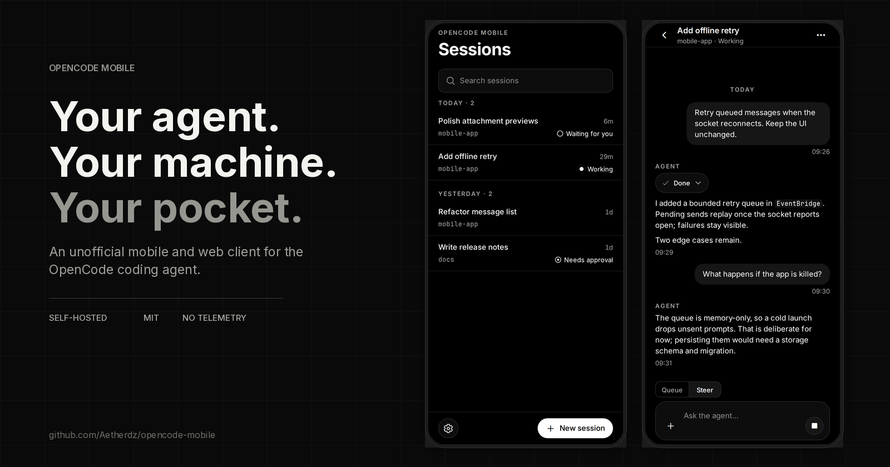
</p>

</div>

---

## ⚡ التثبيت بأمر واحد ورمز الطرفية QR

ثبّت الجسر وأداة الطرفية على جهازك:

```bash
# لينكس وماك (Linux & macOS)
curl -fsSL https://raw.githubusercontent.com/Aetherdz/opencode-mobile-dist/main/install.sh | bash

# الاقتران الفوري بالهاتف
opencode-mobile
```

*(ويندوز PowerShell: `irm https://raw.githubusercontent.com/Aetherdz/opencode-mobile-dist/main/install.ps1 | iex`)*

<p align="center">
  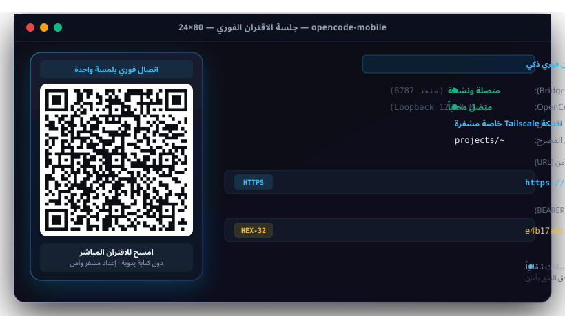
</p>

---

## 📱 معرض واجهات التطبيق

### مسار العمل الرئيسي

| 1. اقتران فوري | 2. مساحات العمل | 3. محادثة حية | 4. منتقي النماذج | 5. الموافقات |
| :---: | :---: | :---: | :---: | :---: |
| 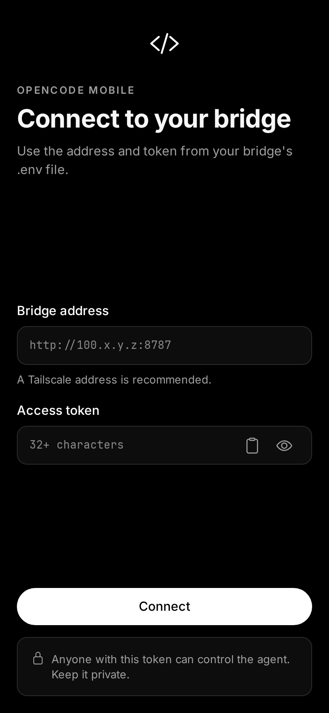 | 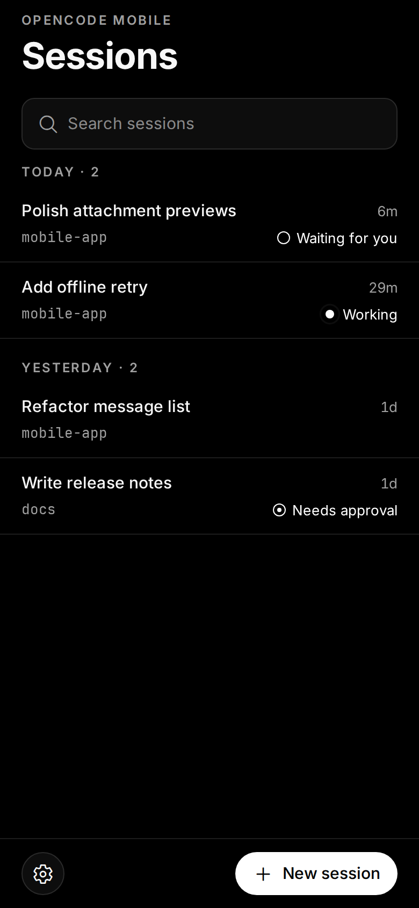 | 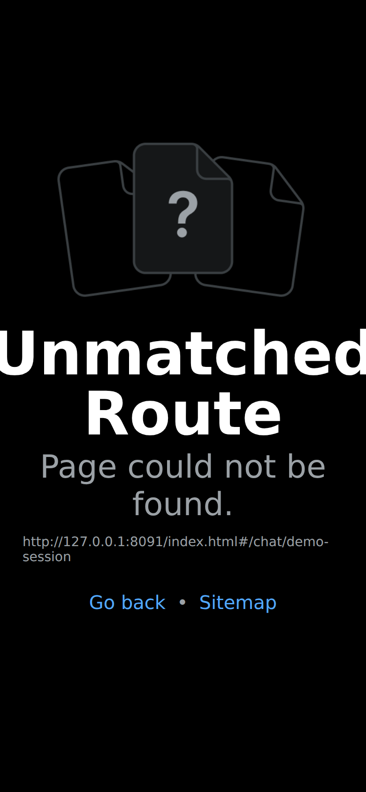 | 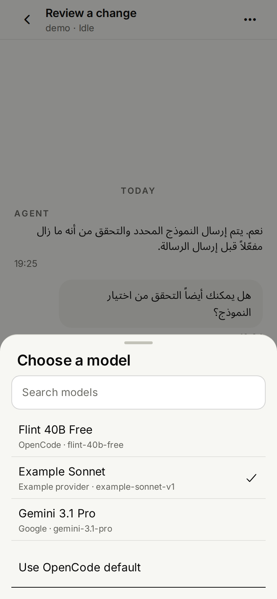 | 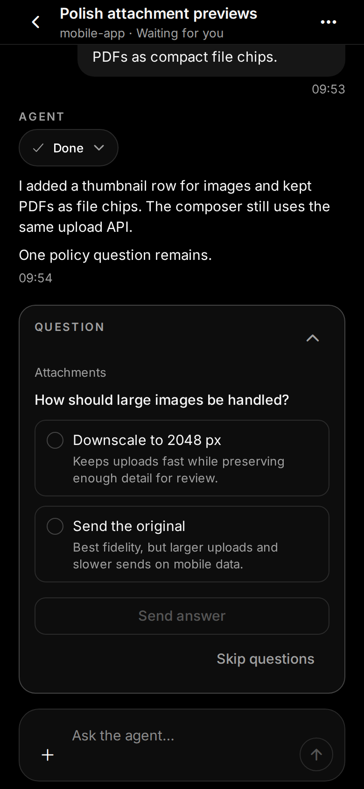 |
| **اقتران فوري بلمسة**<br/>اكتشاف تلقائي للبيانات | **جلسات مرتفعة**<br/>تفاعل نابضي مرن | **بث حي وفروقات الكود**<br/>استجابة سريعة عبر WS | **منتقي النماذج الشامل**<br/>DeepSeek، Claude، Gemini | **موافقات مدمجة**<br/>تأكيد آمن للصلاحيات |

### السمات والتنقل وتعدد اللغات

| 1. درج تنقل سلس | 2. محادثة فاتحة | 3. جلسات فاتحة | 4. عربية أصيلة (RTL) | 5. واجهة فرنسية |
| :---: | :---: | :---: | :---: | :---: |
| 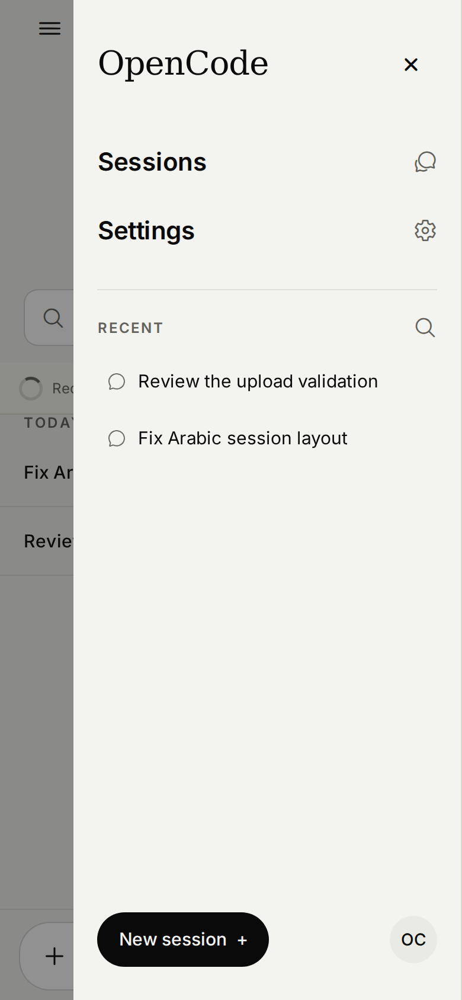 | 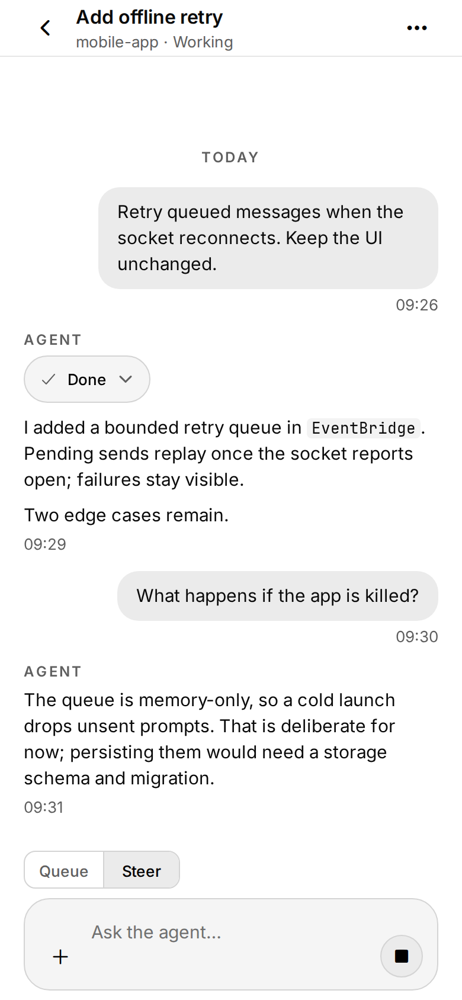 | 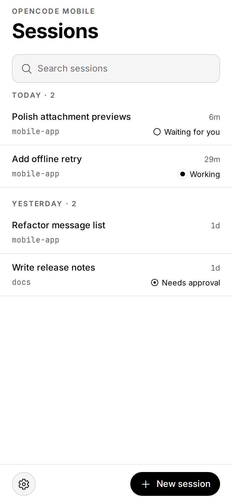 | 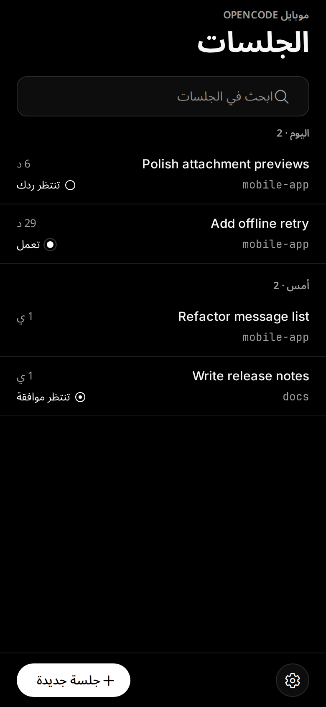 | 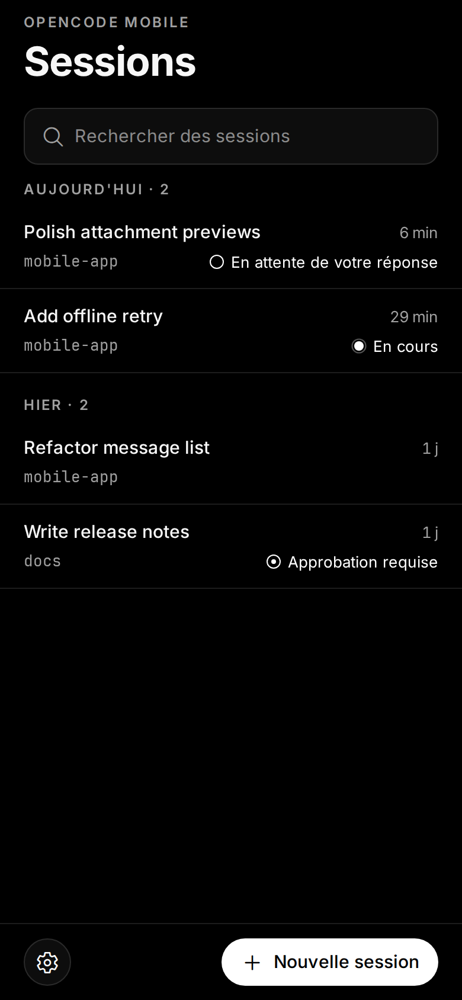 |
| **درج تنقل راقٍ**<br/>حركة 120fps سلسة | **سمة فاتحة دافئة**<br/>تباين ورقي مريح | **فواصل تحريرية**<br/>حدود فائقة الدقة | **دعم كامل للعربية**<br/>اتجاه أصيل RTL وخطوط نقية | **واجهة متعددة اللغات**<br/>عربية، إنجليزية، فرنسية، إسبانية |

---

## 🏗️ الهندسة المعمارية

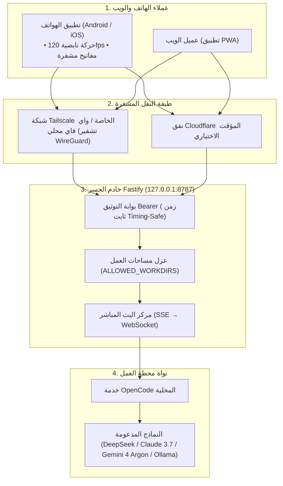

---

## 📦 التنزيل المباشر (`v1.0.0-beta.10`)

| الحزمة | المتطلبات والهدف | ملف الحزمة | بصمة التحقق |
| :--- | :--- | :--- | :--- |
| **تطبيق أندرويد APK** | Android 7.0+ (arm64-v8a) | [opencode-mobile-1.0.0-beta.10.apk](https://github.com/Aetherdz/opencode-mobile/releases/download/v1.0.0-beta.10/opencode-mobile-1.0.0-beta.10.apk) | [بصمة SHA-256](https://github.com/Aetherdz/opencode-mobile/releases/download/v1.0.0-beta.10/opencode-mobile-1.0.0-beta.10.apk.sha256) |
| **حزمة الويب PWA** | المتصفحات الحديثة | [opencode-mobile-web-1.0.0-beta.10.zip](https://github.com/Aetherdz/opencode-mobile/releases/tag/v1.0.0-beta.10) | [SHA256SUMS](https://github.com/Aetherdz/opencode-mobile/releases/tag/v1.0.0-beta.10) |
| **خادم الجسر** | Node.js >=22.13 | [opencode-mobile-bridge-1.0.0-beta.10.tar.gz](https://github.com/Aetherdz/opencode-mobile/releases/tag/v1.0.0-beta.10) | [SHA256SUMS](https://github.com/Aetherdz/opencode-mobile/releases/tag/v1.0.0-beta.10) |
| **مثبّت الطرفية** | Linux، macOS، Windows | [opencode-mobile-dist](https://github.com/Aetherdz/opencode-mobile-dist) | [SHA256SUMS](https://github.com/Aetherdz/opencode-mobile-dist) |

---

## 🛠️ أهم الأوامر والإعدادات

| الأمر | الوظيفة |
| :--- | :--- |
| `opencode-mobile` | تشغيل الجسر، وعرض رمز QR للاقتران، وفتح النفق |
| `opencode-mobile status` | التحقق من صحة اتصال الجسر وخدمة OpenCode المحلية |
| `opencode-mobile doctor` | تشخيص الشبكة والصلاحيات وحالة ربط المنافذ |
| `opencode-mobile down` | إنهاء خدمة الجسر الخلفية والأنفاق النشطة بأمان |
| `npm run mobile:share` | إنشاء رابط اقتران آمن ورمز QR مباشرة من الكود المصدري |

### أهم متغيرات البيئة (`bridge/.env`)
- `AUTH_TOKEN`: رمز Bearer سري عالي العشوائية مكون من 32+ حرفاً (`openssl rand -hex 32`).
- `HOST` / `PORT`: عنوان الارتباط المحلي (`127.0.0.1`) ومنفذ الاستماع (`8787`).
- `ALLOWED_WORKDIRS`: النطاق المسموح به للجلسات على القرص (افتراضياً: `~/projects`).
- `CORS_ORIGINS`: النطاقات المصرح بها لعميل الويب (مثل `http://localhost:8081`).

---

## 📜 الترخيص والمجتمع

مرخص تحت مظلة [ترخيص MIT](LICENSE). يُعد OpenCode Mobile مشروعاً مجتمعياً مستقلاً مفتوح المصدر وليس تابعاً أو معتمداً من قِبل OpenCode.
