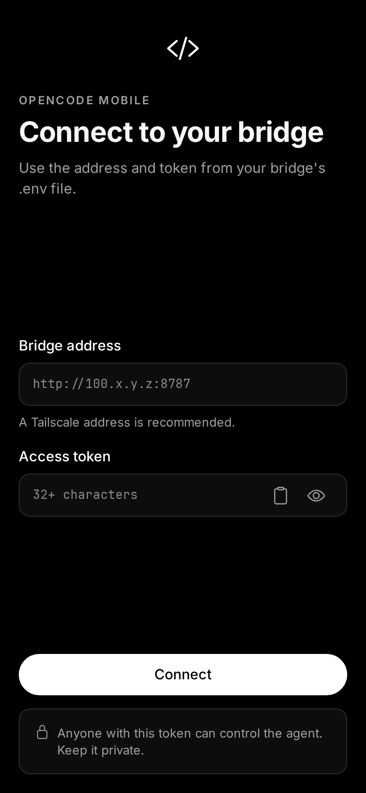
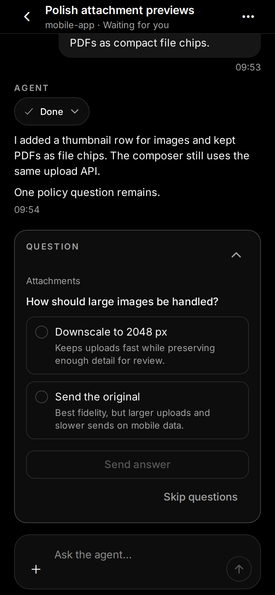
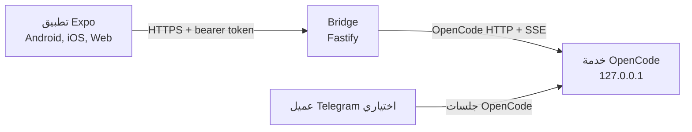

# OpenCode Mobile

عميل غير رسمي للهاتف والويب لـ [OpenCode](https://github.com/anomalyco/opencode)، يعتمد على Bridge صغير ومحمي يعمل بجانب خدمة OpenCode الموجودة على جهازك.

[](https://github.com/Aetherdz/opencode-mobile/stargazers)
[](https://github.com/Aetherdz/opencode-mobile/releases)
[](LICENSE)
[](docs/development.md)
[](https://nodejs.org/)

[الموقع](https://aetherdz.github.io/opencode-mobile/) · [التثبيت](https://aetherdz.github.io/opencode-mobile/#install) · [توثيق الموقع](https://aetherdz.github.io/opencode-mobile/docs/) · [الإصدارات](https://github.com/Aetherdz/opencode-mobile/releases) · [التوثيق](docs/) · [English](README.md)

[English](README.md) | **العربية**

| الاتصال | الجلسات | المحادثة | السؤال |
| --- | --- | --- | --- |
|  |  |  |  |

> الصور مأخوذة من نسخة الويب باستخدام بيانات تجريبية اصطناعية. لا تحتوي على tokens حقيقية أو مسارات خاصة أو أسماء جلسات شخصية.

## لماذا هذا المشروع

OpenCode يعمل على جهازك، لكنك لا تكون أمامه دائماً. هذا المشروع ينقل ما يحتاج إلى تدخل بشري إلى الهاتف: قراءة رد متدفق، الإجابة على سؤال الوكيل، الموافقة على صلاحية أداة، أو إرفاق ملف.

التطبيق لا يشغّل وكيلاً ثانياً، ولا يعرض terminal على الهاتف. الـBridge هو عميل آخر موثّق لخدمة OpenCode الموجودة أصلاً على الجهاز.

## المزايا

- الاتصال بـBridge محلي عبر LAN أو Tailscale باستخدام bearer token.
- قائمة جلسات مع البحث والتجميع وحالة الانتظار والتحديث والإنشاء وإعادة التسمية والحذف.
- محادثة مع streaming وإعادة اتصال وتحميل رسائل أقدم والانتقال إلى آخر رسالة.
- أسئلة الوكيل وطلبات الصلاحيات داخل الواجهة، مع تأكيد صريح للأدوات الخطرة.
- إرفاق صور وكاميرا ومستندات، مع إعادة المحاولة والتنزيل الموثّق.
- ملخصات أدوات، عرض diff، وتلوين كود أحادي اللون.
- الوضع الداكن والفاتح، واجهة بالإنجليزية والعربية والفرنسية، ونصوص مختلطة وRTL.
- إشعارات Expo اختيارية عند انتهاء المهمة أو وجود سؤال أو طلب موافقة.
- نسخة ويب عبر Expo Web مع قائمة origins مسموحة في الـBridge عبر `CORS_ORIGINS`. الوصول من origin مختلف معطّل افتراضياً.

غير منفّذ حالياً: تبديل model أو agent، اختيار model لكل جلسة، بوت Telegram مدمج، ونسخة desktop أصلية. التطبيق يعرض مصدر `telegram` إذا استُخدم عميل OpenCode آخر.

## كيف يعمل



الـBridge يكتشف خدمة OpenCode المحلية، يتوثق معها، ويحوّل HTTP/SSE إلى REST وWebSocket أصغر للتطبيق. كذلك يحفظ سجل المرفقات وتسجيلات push الاختيارية. هو ليس وكيلاً ثانياً ولا يعدّل OpenCode نفسه.

التفاصيل في [docs/architecture.md](docs/architecture.md).

## المتطلبات والتوافق

| المكوّن | المتطلب |
| --- | --- |
| OpenCode | تم التحقق مع `2.0.24` في أكتوبر 2026. الـAPI قد يتغير بين الإصدارات. |
| Node.js | `22.13` أو أحدث؛ يفضّل Node 24 LTS. |
| npm | 10 أو أحدث. |
| Expo | SDK 58 / React Native 0.88. |
| Android | API 24 أو أحدث. ملف APK الموقّع للإصدار مخصص لـarm64-v8a. |
| iOS | ابنِ عبر Expo/EAS على macOS. المستودع لا ينتج iOS binary في CI. |
| Web | Chromium أو Firefox أو Safari حديث. الويب يستخدم `sessionStorage` للتوكن. يحتاج الـBridge إلى same-origin proxy للوصول إلى API. |
| الشبكة | loopback على الجهاز، مع Tailscale أو نفق خاص للهاتف. |

ثبّت الإصدارات الموجودة في `app/package-lock.json` و`bridge/package-lock.json`. لا تفترض أن إصدار OpenCode الأحدث يحافظ على نفس شكل HTTP أو الأحداث.

## البدء السريع

> الأوامر التالية تدير Bridge على Linux/macOS فقط عبر مستودع التوزيعة؛ راجع المثبّت قبل تشغيله. لا تدّعي دعم Windows لهذه الأوامر.

### إعداد الجهاز مرة واحدة (Linux/macOS)

راجع [مثبّت التوزيعة](https://github.com/Aetherdz/opencode-mobile-dist) قبل تشغيله؛ أمر الموقع يجلب نسخة `main` ولذلك يثق بذلك الفرع:

```bash
mkdir -p "$HOME/.local/share/opencode-mobile-installer" && cp install.sh "$HOME/.local/share/opencode-mobile-installer/install.sh" && chmod 700 "$HOME/.local/share/opencode-mobile-installer/install.sh" && bash "$HOME/.local/share/opencode-mobile-installer/install.sh" setup --workdir "$HOME/projects"
opencode-mobile up
```

يجلب الأمر المثبّت من فرع `main` في GitHub؛ هذا أسهل لكنه يثق بالفرع. يتم التحقق من ملفات إصدار الجسر عبر `SHA256SUMS` بعد تنزيلها.

يتحقق `setup` من إصدار الجسر عبر `SHA256SUMS`، ويستخدم مجلد مشاريع محددًا، ويحافظ على الرمز والإعدادات الموجودة، ويبقي الجسر على `127.0.0.1`. يبدأ `up` OpenCode والجسر ويفحص الصحة، ثم ينشئ نفق Cloudflare عامًا مؤقتًا بعد موافقة صريحة في كل مرة. يُنزّل `cloudflared` الرسمي ويتحقق من SHA-256 ويضعه في مجلد المستخدم دون sudo على الأنظمة المدعومة. من يملك الرابط والرمز يستطيع التحكم بالوكيل؛ الرابط يتغير ولا يُحفظ. تتوفر أوامر `down` و`status` و`doctor` و`apk`. ملف APK الحالي لمعمارية arm64-v8a فقط. يبدأ التطبيق بالإنجليزية، ويمكن اختيار العربية أو الفرنسية من الإعدادات.

### 1. تشغيل OpenCode

```bash
opencode service start
```

الـBridge يجد الخدمة عبر `~/.local/state/opencode/service.json`. يمكنك أيضاً ضبط `OPENCODE_URL` و`OPENCODE_PASSWORD` صراحةً. يجب أن يكون العنوان loopback.

### 2. تشغيل الـBridge

```bash
cd bridge
npm ci
cp .env.example .env
openssl rand -hex 32
# ضع القيمة الناتجة في AUTH_TOKEN.
# اضبط ALLOWED_WORKDIRS على جذور المشاريع المسموح بها.
npm run build
npm start
```

يستمع الـBridge افتراضياً على `127.0.0.1:8787`.

### 3. التحقق

```bash
curl http://127.0.0.1:8787/health
# {"ok":true}
```

### 4. تشغيل التطبيق

```bash
cd app
npm ci
npx expo start
```

لمعاينة الويب:

```bash
npm run web
```

نسخة الويب تعمل، لكن الـBridge لا يقبل طلبات المتصفح إلا من origins محددة صراحة. أضف origin الخاص بـExpo Web إلى `bridge/.env` قبل تشغيل الـBridge:

```dotenv
CORS_ORIGINS=http://localhost:8081,http://127.0.0.1:8081
```

`CORS_ORIGINS` يقبل قيم `http://host:port` أو `https://host:port` فقط، ويرفض wildcards والcredentials والمسارات. القيمة الفارغة تعطّل CORS. وجود origin مسموح لا يغني عن الـbearer token؛ وللنشر العام يُفضّل وضع التطبيق والـBridge خلف same origin عبر reverse proxy.

يُرفق APK موقّع بمفتاح المشروع على GitHub Release، مع ملف تحقق SHA-256. ثبّت الملف من صفحة الإصدارات وتأكد من البصمة قبل التثبيت. المشروع لا ينتج نسخة Play Store.

### 5. الاتصال

في الشاشة الأولى أدخل عنوان الـBridge وقيمة `AUTH_TOKEN` نفسها. على الهاتف استخدم عنواناً خاصاً قابلاً للوصول مثل عنوان Tailscale، وليس `127.0.0.1` الخاص بالجهاز المضيف.

## التحميل

| الملف | ملاحظات |
| --- | --- |
| [APK أندرويد](https://github.com/Aetherdz/opencode-mobile/releases/download/v1.0.0-beta.2/opencode-mobile-1.0.0-beta.2.apk) | `1.0.0-beta.2`، موقّع للإصدار، arm64-v8a، أندرويد 7.0+ |
| [حزم Bridge](https://github.com/Aetherdz/opencode-mobile/releases/tag/v1.0.0-beta.2) | `.tar.gz` و`.zip` مع `SHA256SUMS` |
| [حزم الويب](https://github.com/Aetherdz/opencode-mobile/releases/tag/v1.0.0-beta.2) | تصدير Expo ثابت مع `SHA256SUMS` |
| [المثبّتات](https://github.com/Aetherdz/opencode-mobile-dist) | مثبّت Bridge للينكس وماك وويندوز |

تحقق من الـAPK قبل التثبيت:

```bash
sha256sum -c opencode-mobile-1.0.0-beta.2.apk.sha256
```

النسخة التجريبية غير موجودة على Google Play. بناء iPhone يحتاج macOS/EAS وهو غير من إنتاج CI.

## الوصول عن بعد

الافتراضي الآمن هو loopback مع Tailscale:

```bash
tailscale serve --bg http://127.0.0.1:8787
```

ثم أدخل عنوان `https://<machine>.<tailnet>.ts.net` في التطبيق. نفق SSH يعمل أيضاً لمعاينة من laptop.

Cloudflare Tunnel ممكن لتجربة قصيرة، لكنه يضع الـBridge خلف عنوان عام. التوكن هو البوابة الوحيدة. لأي استخدام أطول استخدم Tailscale وأبقِ `HOST=127.0.0.1`.

لا تربط الـBridge بـ`0.0.0.0` وتعرض المنفذ مباشرة للإنترنت.

## نموذج الأمان

باختصار: **توكن الـBridge يعادل صلاحية shell على جهازك.** من يملكه يستطيع أن يطلب من الوكيل قراءة ملفات وتشغيل أوامر وتعديل كود داخل مجلدات العمل المسموح بها.

المنفّذ حالياً:

- توثيق bearer token لـREST وWebSocket.
- مقارنة توكن بزمن ثابت، وحظر محاولات فاشلة، وrate limit.
- التحقق من التوكن قبل تحليل body الطلب؛ `/health` هو المسار الوحيد غير الموثّق.
- قوائم أنواع وامتدادات مسموحة للمرفقات، وحدود حجم، وتنقية أسماء، وتخزين داخل `ALLOWED_WORKDIRS`.
- تنزيل موثّق مع `nosniff` و`X-Frame-Options: DENY` وattachment disposition.
- تنقيح السجلات من authorization وcookies وquery tokens والمسارات الخام.
- تخزين التوكن في SecureStore على native، و`sessionStorage` في الويب.
- توقيع APK بمفتاح المشروع والتحقق من الشهادة في CI.

غير محمي:

- يوجد توكن واحد مشترك، بلا تفويض لكل مستخدم.
- لا يوجد end-to-end encryption بين التطبيق والـBridge.
- نسخ native تسمح بـcleartext HTTP للاتصال المحلي وTailscale.
- WebSocket يستخدم تذكرة قصيرة لمرة واحدة عند الاتصال؛ لا تسجّل query strings.
- قد تظهر بيانات جلسات OpenCode الواقعة خارج `ALLOWED_WORKDIRS` في القائمة، لكن المحتوى والرسائل والموافقات والـdiff والرفع وإيقاف/حذف الجلسة مرفوضة.
- إشعارات push الاختيارية تمر عبر Expo، والـpayload يحتوي IDs ونصوصاً عامة لا نصوص الرسائل.

دوّر `AUTH_TOKEN` إذا سبق مشاركته أو ظهوره في log أو لقطة شاشة. أبقِ الـBridge على شبكة خاصة. راجع [SECURITY.md](SECURITY.md) و[docs/security.md](docs/security.md).

## الإعدادات

| المتغير | الافتراضي | الوصف |
| --- | --- | --- |
| `PORT` | `8787` | منفذ الـBridge. |
| `HOST` | `127.0.0.1` | عنوان الاستماع. أبقِه loopback. |
| `AUTH_TOKEN` | مطلوب | توكن مشترك، 32 حرفاً على الأقل. |
| `OPENCODE_URL` | يُكتشف تلقائياً | عنوان OpenCode صريح. يجب أن يكون loopback. |
| `OPENCODE_PASSWORD` | يُكتشف تلقائياً | كلمة مرور OpenCode عند استخدام عنوان صريح. |
| `ALLOWED_WORKDIRS` | مجلد المنزل | جذور مسموح بها للجلسات والمرفقات. اضبطها بدقة. |
| `CORS_ORIGINS` | فارغ | origins المتصفح المسموح بها، بصيغة دقيقة. الفراغ يعطّل CORS، ويرفض wildcards والمسارات. |
| `MAX_UPLOAD_MB` | `25` | حد الملف الواحد. |
| `MAX_UPLOAD_TOTAL_MB` | `100` | حد إجمالي الطلب. |
| `MAX_FILES_PER_MESSAGE` | `10` | عدد المرفقات. |
| `ALLOWED_UPLOAD_TYPES` | قائمة مدمجة | MIME types وامتدادات مفصولة بفواصل. |
| `DATA_DIR` | `./data` | سجل المرفقات وpush والحالة المحلية. |
| `BAN_AFTER` | `10` | محاولات فاشلة قبل الحظر المؤقت. |
| `BAN_MINUTES` | `15` | مدة الحظر. |
| `RATE_LIMIT_PER_MINUTE` | `180` | حد الطلبات في الدقيقة. |
| `LOG_LEVEL` | `info` | مستوى سجلات Pino. |
| `PUSH_ENABLED` | `1` | اجعله `0` لتعطيل تسجيل Expo push. |

## بنية المشروع

```text
opencode-mobile/
  app/                 عميل Expo Router
  bridge/              Bridge Fastify
  shared/              أنواع REST وWebSocket المشتركة
  docs/                architecture وsecurity وdevelopment وweb وAPI
  deploy/              Docker وsystemd وCaddy ودليل التشغيل
  website/             الموقع العام الثابت
  scripts/             تعديل web export وأدوات Android SDK وAPK
  .github/             CI وPages وقوالب Issues
  ROADMAP.md           المراحل والقرارات المفتوحة
  README.md            README بالإنجليزية
  README.ar.md         هذا الملف
  LICENSE              MIT
  THIRD_PARTY_NOTICES.md
```

## التطوير

```bash
npm run install:app
npm run install:bridge
npm run check
```

`npm run check` يشغّل typecheck للتطبيق، lint للتطبيق، typecheck للـBridge، واختبارات الـBridge.

أوامر مفيدة:

```bash
npm run dev:bridge       # Bridge في watch mode
npm run dev:app          # Expo dev server
npm run build:bridge     # بناء bridge/dist
cd app && npm run web:export
```

بناء Android أسهل عبر EAS. للبناء المحلي، ولّد المشروع الأصلي أولاً:

```bash
cd app
npx expo prebuild --platform android
```

ثم استخدم Android Studio، أو على Linux شغّل `scripts/bootstrap-android-sdk.sh` و`scripts/build-apk.sh`. السكربتات اختيارية وتفترض وجود `app/android`.

راجع [docs/development.md](docs/development.md) لملاحظات Linux وmacOS وWindows وWSL2 وEAS والسيرفرات، و[docs/release.md](docs/release.md) للإصدارات وتوقيع APK والحزم وchecksums.

## الاختبار

```bash
cd bridge
npm test
npm run build

cd ../app
npx tsc --noEmit
npm run lint
npx expo export --platform web
```

اختبارات الـBridge تغطي config وauth وuploads وWebSocket وmapping وstate. التطبيق لا يملك automated UI tests بعد؛ اختبار الجهاز مدرج في الـroadmap.

## المساهمة

اقرأ [CONTRIBUTING.md](CONTRIBUTING.md). الـpull requests الصغيرة والمركزة مفضلة. شغّل `npm run check` قبل فتح PR.

## استكشاف الأخطاء

- **`401 unauthorized`** — التوكن في التطبيق لا يطابق `AUTH_TOKEN`. أعد نسخه واتصل.
- **لا يمكن الوصول إلى الـBridge** — غالباً `HOST` هو loopback. استخدم Tailscale أو `tailscale serve` أو نفق SSH. تحقق من المنفذ والجدار الناري.
- **المرفقات مرفوضة** — تحقق من النوع والحجم وعدد الملفات ومن أن مجلد الجلسة داخل `ALLOWED_WORKDIRS`.
- **الأسئلة أو الموافقات لا تظهر** — تأكد من اتصال WebSocket وأن التطبيق في المقدمة. تحقق من إصدار OpenCode؛ أسماء الأحداث قد تتغير.
- **push غير متاح** — يحتاج EAS `projectId` وجهازاً فعلياً وإذن إشعارات.
- **التوكن يختفي بعد تحديث الويب** — مقصود. الويب يستخدم `sessionStorage`، وnative يستخدم SecureStore.
- **Android يمنع cleartext HTTP** — التطبيق يسمح به للاستخدام المحلي وTailscale. لا تستخدم Bridge عاماً على HTTP.
- **`npm ci` يفشل** — استخدم Node 22.13 أو أحدث والـlockfiles الملتزمة.

التفاصيل في [docs/troubleshooting.md](docs/troubleshooting.md).

## خارطة الطريق

الخطة التفصيلية ومعايير القبول والقرارات المفتوحة في [ROADMAP.md](ROADMAP.md).

المنشور:

- المصدر: <https://github.com/Aetherdz/opencode-mobile>
- مثبّتات الطرفية: <https://github.com/Aetherdz/opencode-mobile-dist>
- الموقع: <https://aetherdz.github.io/opencode-mobile/>
- حزم Bridge والويب لإصدار beta مع checksums في GitHub Releases.
- APK أندرويد موقّع للإصدار: <https://github.com/Aetherdz/opencode-mobile/releases/tag/v1.0.0-beta.2>

المتبقي:

- اختبار الجهاز على أجهزة أندرويد حقيقية.
- أيقونة محايدة وموقف نهائي من العلامة التجارية.
- تبديل model وagent عبر الـBridge.
- TestFlight على iOS وقرار desktop wrapper.

## الترخيص

MIT. راجع [LICENSE](LICENSE).

## تنويه

هذا مشروع مجتمعي غير رسمي. غير تابع لـOpenCode ولا مدعوم منه. أسماء OpenCode وExpo وReact وTailscale وCloudflare وTelegram مملوكة لأصحابها. لا يُستخدم شعار طرف ثالث كادعاء تأييد.

## شكر وتقدير

- [OpenCode](https://github.com/anomalyco/opencode) للوكيل والـAPI المحلي.
- [Expo](https://expo.dev) و[React Native](https://reactnative.dev) لعميل الهاتف.
- مشاريع Inter وNoto Sans Arabic وJetBrains Mono للخطوط.
- [Ionicons](https://ionic.io/ionicons) للأيقونات.
