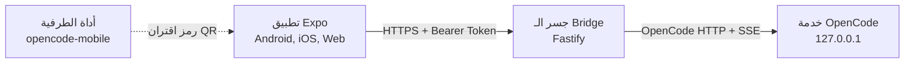

<div align="center">

# OpenCode Mobile

**وكيلك البرمجي. جهازك الشخصي. في جيبك.**

عميل غير رسمي للهاتف المحمول والويب لوكيل البرمجة [OpenCode](https://github.com/anomalyco/opencode)، مدعوم بهندسة **Gemini 4 Argon**. يعمل بالاستضافة الذاتية، وموثّق برمز Bearer، وخالٍ تماماً من التتبع (Zero Telemetry)، ومصمم للمواقف التي تكون فيها بعيداً عن لوحة المفاتيح وتحتاج إلى توجيه الوكيل.

[الموقع](https://aetherdz.github.io/opencode-mobile/) ·
[التثبيت](https://aetherdz.github.io/opencode-mobile/#install) ·
[توثيق الموقع](https://aetherdz.github.io/opencode-mobile/docs/) ·
[الإصدارات](https://github.com/Aetherdz/opencode-mobile/releases) ·
[التوثيق](docs/) ·
[English](README.md)

[](https://github.com/Aetherdz/opencode-mobile/stargazers)
[](https://github.com/Aetherdz/opencode-mobile/releases)
[](https://github.com/Aetherdz/opencode-mobile/actions/workflows/ci.yml)
[](LICENSE)

</div>

## ما هو المشروع

يعمل OpenCode مباشرة على جهاز التطوير الخاص بك. يربط OpenCode Mobile حلقة التفاعل البشري بهاتفك: قراءة الإجابات المتدفقة فوراً، الرد على استفسارات الوكيل، منح صلاحيات تشغيل الأدوات، فحص الفروقات البرمجية (diff)، وإرفاق الصور والمستندات.

التطبيق **لا** يشغّل وكيلاً سحابياً ثانياً ولا يعرض طرفية مفتوحة غير منضبطة. يقوم جسر (Bridge) خفيف وموثّق بربط تطبيق الهاتف بخدمة OpenCode المشغّلة بالفعل على جهازك.

## استعراض المزايا المعمارية (بمحرك Argon 4)

يمثل الإصدار **v1.0.0-beta.10** نقلة معمارية نوعية هندسية بدقة متناهية:

- ⚡ **تكامل محرك Gemini 4 Argon فائق الاستدلال**: دعم مدمج لنموذج Argon 4 (`antigravity-gemini-4-argon`) مع اكتشاف تلقائي للنماذج المحلية وتبديل سلس من شريط الأدوات السفلي.
- 🚀 **تثبيت بأمر واحد مبسط**: إعداد البيئة بالكامل عبر أمر واحد في الطرفية:
  ```bash
  curl -fsSL https://raw.githubusercontent.com/Aetherdz/opencode-mobile-dist/main/install.sh | bash
  ```
- 📲 **اتصال تلقائي بلمسة واحدة عبر QR**: ربط هاتفك في ثوانٍ. امسح رمز QR المرسوم في الطرفية بواسطة أداة `opencode-mobile` لملء البيانات والاتصال المباشر دون الحاجة لضغط أزرار إضافية.
- 🎴 **بطاقات جلسات مرتفعة وسلسة**: تصميم مطوّر لقائمة الجلسات ببطاقات حديثة elevated مع تفاعل لمسي ناعم (tactile scaling)، وحواف منحنية أنيقة، ومؤشرات حالة واضحة.
- 🛡️ **وصول مقيّد لمجلدات العمل**: حماية صارمة تحصر العمل داخل `ALLOWED_WORKDIRS` (`~/projects`)، مع حوارات تفاعلية فورية تتيح منح أذونات تشغيل للجلسات الخارجية بلمسة واحدة.
- 🔒 **صفر تتبع وسيادة تامة على البيانات (Zero Telemetry)**: استضافة ذاتية 100%، وتواصل مباشر peer-to-peer عبر الشبكة المحلية أو شبكة Tailscale الخاصة، بدون أي مراقبة أو تحليلات سحابية خارجية.
- 🌐 **دعم كامل للغات العربية والإنجليزية والفرنسية وRTL**: دعم أصيل للاتجاه من اليمين لليسار، مع عرض ذكي للنصوص ثنائية الاتجاه (العربية RTL والإنجليزية/الفرنسية LTR) ومصطلحات معرّبة بدقة.

## لقطات الشاشة (بيانات تجريبية)

لقطات حقيقية من واجهة العميل (Expo Web) على واجهة برمجة تجريبية محلية:

| الجلسات | المحادثة | اختيار النموذج |
| --- | --- | --- |
|  |  |  |

## أهم المزايا

- **الاتصال عبر LAN أو Tailscale** باستخدام رمز Bearer واحد واكتشاف تلقائي.
- **إدارة كاملة للجلسات**: بحث، تجميع، مؤشرات الحالة (خامل، قيد العمل، بانتظار إجابة)، إنشاء وإعادة تسمية وحذف.
- **محادثة متدفقة في الوقت الفعلي**: معالجة انقطاع الاتصال التلقائية، تصفح الرسائل السابقة، والتمرير السريع لآخر رسالة.
- **تفاعل متكامل مع الوكيل**: أسئلة داخل المحادثة، طلبات صلاحيات الأدوات، وتأكيد صريح للعمليات التدميرية.
- **مرفقات متعددة**: التقاط بالكاميرا، اختيار من معرض الصور، ورفع المستندات مع تنزيل موثّق وآمن.
- **ملخصات الأدوات وفروقات الكود**: عروض تفاعلية لـ diff مع تلوين نحوي أحادي اللون مريح للعين.
- **إشعارات Push اختيارية**: تنبيهات عبر Expo عند اكتمال مهام الوكيل أو الحاجة لموافقة.
- **نسخة ويب (Expo Web)**: عميل ويب متكامل يدعم حصر نطاقات الـ CORS بأمان (`CORS_ORIGINS`).

## البدء السريع

### التثبيت بأمر واحد (Linux / macOS)

ثبّت الـ Bridge وأدوات الطرفية بأمر واحد:

```bash
curl -fsSL https://raw.githubusercontent.com/Aetherdz/opencode-mobile-dist/main/install.sh | bash
```

بعد انتهاء الإعداد، شغّل أداة الربط:

```bash
opencode-mobile
```

يقوم الأمر بفحص الخدمة وعرض رمز QR ملون في الطرفية للربط الفوري. على أجهزة Linux المتصلة بـ Tailscale، يتم تفعيل ميزة Tailscale Serve الخاصة والمستمرة تلقائياً.

### التثبيت اليدوي من المصدر

إذا كنت تفضل البناء والتشغيل من الكود المصدري:

#### 1. تشغيل OpenCode
```bash
opencode service start
```
يكتشف الـ Bridge الخدمة المحلية تلقائياً عبر `~/.local/state/opencode/service.json`.

#### 2. تشغيل الـ Bridge
```bash
cd bridge
npm ci
cp .env.example .env
openssl rand -hex 32   # ضع هذه القيمة في AUTH_TOKEN
npm run build
npm start
```

افتراضياً، يتم ضبط `ALLOWED_WORKDIRS` على `~/projects`. يستمع الـ Bridge على `127.0.0.1:8787`.

فحص سلامة الخدمة:
```bash
curl http://127.0.0.1:8787/health
# {"ok":true}
```

#### 3. تشغيل التطبيق
```bash
cd app
npm ci
npx expo start
```

لتشغيل نسخة الويب:
```bash
npm run web
```
أضف رابط الويب إلى `bridge/.env`:
```dotenv
CORS_ORIGINS=http://localhost:8081,http://127.0.0.1:8081
```

## التنزيل

الإصدار **`1.0.0-beta.10`** هو الإصدار العام الحالي. ملف الـ APK الموقّع مخصص لمعمارية `arm64-v8a`.

| الملف | ملاحظات |
| --- | --- |
| [APK أندرويد](https://github.com/Aetherdz/opencode-mobile/releases/download/v1.0.0-beta.10/opencode-mobile-1.0.0-beta.10.apk) | [بصمة SHA-256](https://github.com/Aetherdz/opencode-mobile/releases/download/v1.0.0-beta.10/opencode-mobile-1.0.0-beta.10.apk.sha256)؛ arm64-v8a |
| [حزم Bridge](https://github.com/Aetherdz/opencode-mobile/releases/tag/v1.0.0-beta.10) | ملفات `.tar.gz` و `.zip` مع بصمات `SHA256SUMS` |
| [حزم الويب](https://github.com/Aetherdz/opencode-mobile/releases/tag/v1.0.0-beta.10) | تصدير ثابت لـ Expo Web مع بصمات `SHA256SUMS` |
| [مثبّت الطرفية](https://github.com/Aetherdz/opencode-mobile-dist) | مثبّت أنظمة Linux و macOS و Windows |

## آلية العمل



يتصل الـ Bridge بخدمة OpenCode عبر الـ loopback، ويتحقق من رموز Bearer، ويوفر واجهة REST و WebSocket مؤمّنة لتطبيق الهاتف. كما يدير سجل المرفقات، والتحقق من الجلسات، وإشعارات Push دون تعديل كود OpenCode الأصلي.

## نموذج الأمان

- **توثيق رمز Bearer**: مقارنة بزمن ثابت (constant-time)، وحدود لمعدل المحاولات، وحظر مؤقت تلقائي لعناوين IP المشبوهة.
- **صفر تتبع**: جميع الاتصالات تتم مباشرة بين جهازك وهاتفك عبر شبكتك المحلية أو Tailscale دون تسريب أي بيانات.
- **تخزين آمن**: حفظ الرموز في `SecureStore` للأنظمة الأصلية (iOS Keychain / Android KeyStore) و `sessionStorage` للويب.
- **حصر الوصول لنظام الملفات**: حصر العمليات داخل `ALLOWED_WORKDIRS` مع طلب موافقة صريحة ومؤقتة لأي جلسة خارجية.
- **مرفقات موثّقة**: فحص نوع الملف وامتداده، وضع حدود قصوى للحجم، وتنقية الأسماء، وتنزيل آمن بترويسات تمنع الثغرات (`nosniff`, `X-Frame-Options: DENY`).

راجع [SECURITY.md](SECURITY.md) و [docs/security.md](docs/security.md) للاطلاع على نموذج التهديدات الكامل.

## الوصول عن بعد

الخيار الآمن والموصى به هو استخدام Loopback مع شبكة Tailscale:

```bash
tailscale serve --bg http://127.0.0.1:8787
```

ثم الاتصال عبر عنوان Tailnet الخاص: `https://<machine>.<tailnet>.ts.net`.

### نفق Cloudflare المؤقت

للعروض السريعة، توفر الأداة نفقاً مؤقتاً اختيارياً. ينتهي تشفير TLS عند Cloudflare ويتطلب الوصول توكن Bearer المشترك. أوقف النفق دائماً عند الانتهاء باستخدام `opencode-mobile down`.

## التطوير والاختبار

```bash
npm run install:app
npm run install:bridge
npm run check
```

يشغّل أمر `npm run check` حزمة التحقق الكاملة:
- فحص الأنواع لتطبيق الهاتف (`tsc --noEmit`)
- فحص الأنواع للـ Bridge (`tsc --noEmit`)
- فحص الكود بأداة ESLint
- اختبارات Bridge عبر Vitest (107 اختبارات)
- اختبارات وحدة أدوات التثبيت (4 اختبارات)

أوامر البناء:
```bash
npm run dev:bridge       # تشغيل Bridge في وضع المراقبة
npm run dev:app          # تشغيل خادم تطوير Expo
npm run build:bridge     # بناء Bridge إلى مجلد bridge/dist
npm run web:export       # تصدير ثابت لتطبيق الويب إلى app/dist
```

## التوثيق

- [الهندسة المعمارية](docs/architecture.md) — تصميم النظام وتدفق الأحداث.
- [الأمان](docs/security.md) — نموذج التهديدات والضوابط الأمنية.
- [دليل التطوير](docs/development.md) — الإعداد عبر Linux و macOS و Windows.
- [عميل الويب](docs/web.md) — إعدادات CORS والـ Reverse Proxy و PWA.
- [دليل الإصدار](docs/release.md) — بناء وتوقيع وحزم الإصدارات والتحقق من البصمات.
- [استكشاف الأخطاء](docs/troubleshooting.md) — حلول المشاكل الشائعة في الاتصال والإعداد.
- [خارطة الطريق](ROADMAP.md) — المراحل التطويرية والخطط المستقبلية.

## المساهمة

يرجى مراجعة [CONTRIBUTING.md](CONTRIBUTING.md) قبل تقديم مساهماتك. شغّل دائماً `npm run check` قبل فتح طلبات السحب (PRs).

## الترخيص

مرخص تحت رخصة MIT. راجع [LICENSE](LICENSE).

## تنويه

مشروع OpenCode Mobile هو مشروع مجتمعي غير رسمي وليس جزءاً من مشروع OpenCode ولا مدعوماً منه بشكل مباشر. كافة العلامات التجارية وأسماء المنتجات مملوكة لأصحابها.
