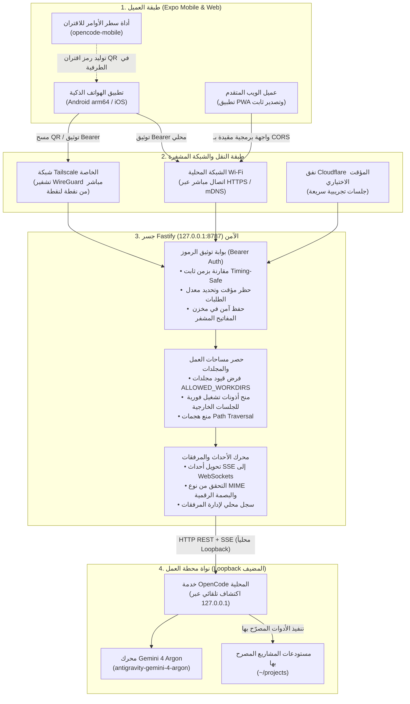

<div align="center">

# OpenCode Mobile

### *وكيلك البرمجي. جهازك الشخصي. في جيبك.*

عميل غير رسمي للهواتف الذكية والأجهزة اللوحية والويب، مصمم خصيصاً لوكيل البرمجة الذكي [OpenCode](https://github.com/anomalyco/opencode)، ومدعوم بهندسة **Gemini 4 Argon** فائقة الاستدلال من Google DeepMind. يعمل بالاستضافة الذاتية، ومؤمّن بالكامل برموز Bearer، وخالٍ تماماً من التتبع (Zero Telemetry)، ومصمم لتوجيه وكيلك البرمجي ومتابعته أينما كنت بعيداً عن محطة عملك.

[الموقع الرسمي](https://aetherdz.github.io/opencode-mobile/) ·
[دليل التثبيت](https://aetherdz.github.io/opencode-mobile/#install) ·
[التوثيق التقني](docs/) ·
[الهندسة المعمارية](docs/architecture.md) ·
[نموذج الأمان](docs/security.md) ·
[إصدارات GitHub](https://github.com/Aetherdz/opencode-mobile/releases) ·
[English (الإنجليزية)](README.md)

<br/>

[](https://github.com/Aetherdz/opencode-mobile/releases)
[](https://deepmind.google/)
[](https://github.com/Aetherdz/opencode-mobile/actions)
[](https://www.typescriptlang.org/)
[](https://expo.dev/)
[](https://fastify.dev/)
[](#نموذج-الأمان-والخصوصية-والسيادة-على-البيانات)
[](LICENSE)

</div>

<br/>

---

## ما هو المشروع

يعمل **OpenCode** مباشرة على محطة عملك البرمجية أو خادمك الخاص مع وصول مباشر لأدواتك المحلية ومستودعات Git والمترجمات ونماذج الذكاء الاصطناعي. ينقل **OpenCode Mobile** هذه القدرات بالكامل إلى جيبك.

يربط التطبيق حلقة التفاعل البشري بالوكيل كلما ابتعدت عن لوحة المفاتيح:
- ⚡ **متابعة الإجابات المتدفقة فورياً** بتقنية Server-Sent Events (SSE) مع تلوين حي للكود المصدري.
- 💬 **الإجابة على استفسارات الوكيل المدمجة** عبر خيارات تفاعلية متعددة وحقول إدخال مخصصة.
- 🛡️ **منح وتأكيد صلاحيات الأدوات** (تعديل الملفات، تشغيل الأوامر بالطرفية، جلب بيانات الويب) مع تأكيد صريح للعمليات التدميرية.
- 🎴 **إدارة مساحات العمل ومستودعات المشاريع** عبر بطاقات جلسات مرتفعة ناعمة الملمس والحركة.
- 📎 **إرفاق السياق البصري والمستندات** عبر التقاط الصور بالكاميرا أو اختيار لقطات الشاشة والملفات المصدرية ورفعها مباشرة للجلسة.

> [!NOTE]
> لا يشغّل OpenCode Mobile وكيلاً ثانياً على السحابة، ولا يعرض طرفية شل غير مقيدة على الهاتف. يعمل النظام عبر جسر Fastify محلي مؤمّن وموثّق يرتبط حصرياً بواجهة loopback المحلية على جهازك.

---

## تجربة الطرفية والتثبيت بأمر واحد

يستغرق الإعداد ثوانٍ معدودة. ثبّت الجسر وأداة الطرفية التفاعلية بأمر واحد:

```bash
curl -fsSL https://raw.githubusercontent.com/Aetherdz/opencode-mobile-dist/main/install.sh | bash
```

بعد اكتمال التثبيت، شغّل الأمر لعرض شاشة الاقتران الفوري ورمز الاستجابة السريعة (ANSI QR Code) في طرفيتك:

```bash
opencode-mobile
```

```text
╭──────────────────────────────────────────────────────────────╮
│  ✦ OpenCode Mobile · Quick Connect                           │
├──────────────────────────────────────────────────────────────┤
│  Bridge Service:    ● Online (Port 8787)                     │
│  OpenCode Agent:    ● Connected                              │
│  Connection Mode:   Secure Tailscale Serve / Local Loopback  │
│                                                              │
│  Connection URL:                                             │
│  https://workstation.tailnet.ts.net                          │
│                                                              │
│  Pairing Token:                                              │
│  e4b17a8c3d90f251a842de561c9b4e07... (32+ chars)            │
│                                                              │
│  Workdir: /home/developer/projects                           │
├──────────────────────────────────────────────────────────────┤
│  ▄▄▄▄▄▄▄ ▄ ▄▄ ▄▄▄▄ ▄▄▄▄▄▄▄                                   │
│  █ ▄▄▄ █ █▄█ █▄███ █ ▄▄▄ █   الاتصال التلقائي بلمسة واحدة:     │
│  █ ███ █ ▄▀█▄█▀▄ █ █ ███ █   وجّه كاميرا الهاتف نحو رمز QR    │
│  █▄▄▄▄▄█ █ █ █ █ █ █▄▄▄▄▄█   للاقتران المباشر وحفظ البيانات    │
│  ▄▄ ▄  ▄▄▀▄▀▄▀▄▄██▄▄  ▄ ▄▄   تلقائياً دون أي كتابة يدوية!     │
│  █▄▄▄▄▄█ █▀▀██▄▀ █ █ ▄ █▄█                                   │
│  ▀▀▀▀▀▀▀ ▀   ▀▀▀▀▀ ▀▀▀  ▀▀                                   │
├──────────────────────────────────────────────────────────────┤
│  امسح الرمز بكاميرا التطبيق للاتصال الفوري والآمن.           │
│  اضغط Ctrl+C لإيقاف الاتصال وإغلاق الجلسة في أي وقت.         │
╰──────────────────────────────────────────────────────────────╯
```

---

## معرض الواجهات المرئي (Screenshots Gallery)

صُممت واجهة المستخدم بعناية فائقة، مع حركة لمسية فيزيائية مرنة، ووضع مظلم وفاتح عالي التباين، ودعم كامل أصيل للغة العربية والاتجاه من اليمين إلى اليسار (RTL):

| 1. الاتصال التلقائي | 2. بطاقات الجلسات | 3. المحادثة الفورية | 4. اختيار نموذج Argon 4 | 5. الموافقة والأسئلة |
| :---: | :---: | :---: | :---: | :---: |
|  |  |  |  |  |
| **اقتران فوري عبر QR**<br/>مسح بالكاميرا واكتشاف ذكي لروابط الحافظة | **بطاقات جلسات مرتفعة**<br/>تفاعل حركي لمسي، مؤشرات الحالة، وتجميع زمني | **محادثة حية وفروقات الكود**<br/>تدفق حي عبر SSE، عروض diff مدمجة وقابلة للطي | **استدلال فائق مع Argon 4**<br/>اكتشاف تلقائي للنماذج وتبديل فوري في الشريط السفلي | **استفسارات الوكيل المدمجة**<br/>خيارات متعددة تفاعلية وتأكيد أمني للصلاحيات |

---

## الهندسة المعمارية للنظام

يعتمد OpenCode Mobile على نموذج دفاعي معماري متعدد الطبقات يربط هاتفك مباشرة بمحطة عملك دون أي خوادم وسيطة خارجية:



### أبرز المزايا المعمارية

1. **تكامل محرك Gemini 4 Argon فائق الاستدلال**: دعم أصيل لعائلة نماذج `antigravity-gemini-4-argon`. يكتشف التطبيق تلقائياً النماذج المتاحة عبر دالة `readConfiguredModels`، مما يتيح التبديل الفوري بين النماذج مباشرة من شريط الأدوات السفلي أثناء المحادثة.
2. **اتصال تلقائي بلمسة واحدة عبر QR**: تصدّر أداة الطرفية رابط اقتران مشفر `opencode-mobile://connect` مرسوماً برمز QR داخل الطرفية. بمجرد توجيه الكاميرا نحوه، يتعرف التطبيق على البيانات فورياً ويتحقق من الاتصال ويحفظه دون أي حاجة للإدخال اليدوي.
3. **بطاقات جلسات مرتفعة**: إعادة هندسة قائمة الجلسات ببطاقات حديثة ذات حواف دائرية مستمرة وتأثير لمسي ناعم، ومؤشرات واضحة لحالة الجلسة (خاملة، قيد المعالجة، بانتظار إجابة)، مع أدوات متكاملة للبحث والتسمية والحذف.
4. **عزل المجلدات وأذونات التشغيل الآمنة**: حماية افتراضية تحصر نشاط الوكيل داخل `ALLOWED_WORKDIRS` (`~/projects`). وعند فتح مستودع يقع خارج هذا النطاق، يعرض التطبيق حواراً أصيلاً لمنح إذن تشغيل مؤقت بلمسة واحدة بأمان تام.
5. **ضمان صفر تتبع (Zero Telemetry)**: لا توجد أي مكتبات تتبع، ولا تحليلات Firebase، ولا تقارير أعطال خارجية. كل البيانات تنتقل مباشرة بين هاتفك وجهازك عبر شبكتك الخاصة والمشفرة.

---

## دليل البدء السريع

### الخيار أ: الإعداد التلقائي عبر الطرفية (الموصى به)

1. **التثبيت بأمر واحد** (أنظمة Linux / macOS):
   ```bash
   curl -fsSL https://raw.githubusercontent.com/Aetherdz/opencode-mobile-dist/main/install.sh | bash
   ```
2. **الاقتران بهاتفك**:
   ```bash
   opencode-mobile
   ```
   وجّه كاميرا الهاتف نحو رمز QR في الطرفية للاتصال المباشر.

أوامر الطرفية المتاحة:
```bash
opencode-mobile status   # فحص سلامة الجسر والوكيل
opencode-mobile doctor   # تشخيص مشاكل الشبكة والأذونات
opencode-mobile down     # إيقاف الجسر والأنفاق النشطة بأمان
opencode-mobile apk      # تنزيل وفحص بصمة ملف APK الموقّع للأندرويد
```

### الخيار ب: الإعداد اليدوي من الكود المصدري

إذا كنت تفضل بناء المشروع وتشغيله مباشرة من المصدر:

#### 1. تشغيل خدمة OpenCode
```bash
opencode service start
```
يكتشف الجسر الخدمة تلقائياً عبر `~/.local/state/opencode/service.json`.

#### 2. تشغيل الجسر (Bridge)
```bash
cd bridge
npm ci
cp .env.example .env
openssl rand -hex 32   # ضع القيمة الناتجة في AUTH_TOKEN
npm run build
npm start
```
فحص استجابة الجسر:
```bash
curl http://127.0.0.1:8787/health
# {"ok":true}
```

#### 3. تشغيل التطبيق (App)
```bash
cd app
npm ci
npx expo start
```
لتشغيل نسخة المتصفح:
```bash
npm run web
```
*(أضف `CORS_ORIGINS=http://localhost:8081` في ملف `bridge/.env` عند تصفح التطبيق من المتصفح).*

---

## مرجع متغيرات البيئة والإعدادات

يتم ضبط إعدادات الجسر عبر متغيرات البيئة أو داخل ملف `bridge/.env`:

| المتغير | القيمة الافتراضية | إلزامي؟ | الوصف والدلالة الأمنية |
| :--- | :--- | :---: | :--- |
| `AUTH_TOKEN` | *لا يوجد* | **نعم** | رمز Bearer السري المشترك. يجب ألا يقل عن **32 حرفاً** بدرجة إنتروبيا عشوائية عالية. يُعامل هذا الرمز كصلاحية وصول للطرفية. |
| `HOST` | `127.0.0.1` | لا | عنوان واجهة الشبكة التي يستمع عليها الجسر. **يجب إبقاؤه loopback دائماً**. يُمنع منعاً باتاً ربطه بـ `0.0.0.0` دون جدار حماية شبكي. |
| `PORT` | `8787` | لا | منفذ HTTP و WebSocket الذي يستمع عليه الجسر. |
| `ALLOWED_WORKDIRS` | `~/projects` | لا | قائمة مسارات مطلقة مفصولة بفواصل مسموح للجلسات والملفات المرفوعة بالوصول إليها. اضبط هذا النطاق بدقة. |
| `CORS_ORIGINS` | *فارغ* | لا | عناوين origins للمتصفح المصرح لها بالاتصال بالجسر (مثل `http://localhost:8081`). الفراغ يعطّل طلبات المتصفح تماماً. |
| `MAX_UPLOAD_MB` | `25` | لا | الحد الأقصى لحجم الملف الواحد المرفوع بالميغابايت. |
| `MAX_UPLOAD_TOTAL_MB` | `100` | لا | الحد الأقصى لإجمالي حجم الملفات المرفوعة في رسالة واحدة بالميغابايت. |
| `MAX_FILES_PER_MESSAGE`| `10` | لا | الحد الأقصى لعدد المرفقات المسموح بها في رسالة واحدة. |
| `ALLOWED_UPLOAD_TYPES` | *مدمج* | لا | أنواع MIME والامتدادات المسموح برفعها، مع حظر البرمجيات التنفيذية والملفات الخطرة تلقائياً. |
| `DATA_DIR` | `./data` | لا | المجلد المحلي المستخدم لحفظ سجل المرفقات ورموز إشعارات Push. |
| `BAN_AFTER` | `10` | لا | عدد المحاولات الفاشلة المتتالية للتوثيق قبل فرض حظر مؤقت على عنوان IP. |
| `BAN_MINUTES` | `15` | لا | مدة الحظر المؤقت بالدقائق لعناوين IP المشبوهة. |
| `RATE_LIMIT_PER_MINUTE`| `180` | لا | الحد الأقصى لعدد طلبات HTTP المسموح بها في الدقيقة لكل عنوان IP. |
| `LOG_LEVEL` | `info` | لا | مستوى تفصيل سجلات Pino (`fatal`, `error`, `warn`, `info`, `debug`, `trace`). يتم إخفاء ترويسات التوثيق تلقائياً. |
| `PUSH_ENABLED` | `1` | لا | اجعله `1` لتفعيل إشعارات Expo Push، أو `0` لتعطيلها نهائياً. |
| `OPENCODE_URL` | *تلقائي* | لا | عنوان loopback الصريح لخدمة OpenCode. يُكتشف تلقائياً من `service.json` إذا تُرك فارغاً. |
| `OPENCODE_PASSWORD` | *تلقائي* | لا | كلمة مرور التوثيق لخدمة OpenCode. تُكتشف تلقائياً عند تركها فارغة. |

---

## نموذج الأمان والخصوصية والسيادة على البيانات

يتبع OpenCode Mobile معايير أمنية صارمة تضمن الحماية الكاملة لجهازك ومستودعاتك:

### 1. صفر تتبع وسيادة كاملة على البيانات (Zero Telemetry)
- لا يحتوي الكود على أي مكتبات تتبع أو تحليلات خارجية أو خوادم قياس عن بُعد.
- رسائل الجلسات، وفروقات الكود، والأوامر، والرموز السرية لا تغادر أجهزتك إطلاقاً إلى أي سحابة خارجية.
- تظل جميع الاتصالات من نقطة لنقطة مباشرة عبر شبكتك المحلية أو شبكة Tailscale المشفرة ببروتوكول WireGuard.

### 2. حصر مساحات العمل والأذونات المؤقتة الآمنة
- يفرض الجسر حدوداً صارمة على مسارات الملفات المسموح بها عبر `ALLOWED_WORKDIRS`.
- لا يمكن استعراض أو التفاعل مع الجلسات خارج المجلدات المصرح بها إلا بعد منح إذن مؤقت صريح عبر حوار أصيل داخل التطبيق.
- يتم فحص وتنقية مسارات الملفات المرفوعة لمنع أي هجمات لتخطي المسارات (`../`).

### 3. توثيق محكم ومقاوم لهجمات التوقيت
- كل مسار برمجيات (باستثناء `/health`) واتصالات WebSocket تتطلب رمز Bearer صالحاً.
- تتم مقارنة الرموز بدالة `crypto.timingSafeEqual` لمنع هجمات التوقيت (Timing Attacks).
- يتم حظر عناوين IP تلقائياً لمدة 15 دقيقة عند تجاوز 10 محاولات دخول فاشلة.
- تستخدم اتصالات WebSocket تذاكر مؤقتة لمرة واحدة لمنع ظهور الرموز السرية في سجلات الوكلاء المعكوسين.

### 4. تخزين آمن لبيانات الاعتماد
- تخزن تطبيقات الهواتف الذكية رموز الاتصال حصرياً داخل مخازن المفاتيح المشفرة عتادياً (`Expo SecureStore` / iOS Keychain / Android KeyStore).
- تخزن نسخة المتصفح الرموز حصرياً في `sessionStorage` المؤقت الذي يُمسح تلقائياً بمجرد إغلاق علامة التبويب.

---

## خيارات الوصول عن بُعد

### الخيار الموصى به: شبكة Tailscale الخاصة والمشفرة
الأسلوب الأكثر أماناً وموثوقية للاتصال عن بُعد هو استخدام [Tailscale](https://tailscale.com):
```bash
tailscale serve --bg http://127.0.0.1:8787
```
ينتج هذا الأمر رابطاً مشفراً وخاصاً (`https://<workstation>.<tailnet>.ts.net`) لا يمكن الوصول إليه إلا من أجهزتك المشتركة في شبكة Tailnet نفسها.

### نفق Cloudflare المؤقت (للعروض السريعة فقط)
للمشاركة المؤقتة والسريعة، توفر أداة `opencode-mobile` نفق Cloudflare مؤقتاً:
- يولّد رابط HTTPS عاماً مؤقتاً يعيد التوجيه إلى جهازك المحلي.
- يظل الوصول محمياً برمز Bearer المشترك.
- ينتهي تشفير TLS عند Cloudflare، لذا يجب إنهاء النفق فوراً عند الانتهاء عبر أمر `opencode-mobile down`.

---

## التنزيلات والإصدارات

الإصدار **`v1.0.0-beta.10`** هو الإصدار العام الحالي المعتمد.

| الملف والمنصة | المعمارية / النظام | التحقق من البصمة الرقمية |
| :--- | :--- | :--- |
| [APK أندرويد (arm64-v8a)](https://github.com/Aetherdz/opencode-mobile/releases/download/v1.0.0-beta.10/opencode-mobile-1.0.0-beta.10.apk) | Android 7.0+ (API 24+) | [بصمة SHA-256](https://github.com/Aetherdz/opencode-mobile/releases/download/v1.0.0-beta.10/opencode-mobile-1.0.0-beta.10.apk.sha256) |
| [حزمة الجسر (.tar.gz)](https://github.com/Aetherdz/opencode-mobile/releases/tag/v1.0.0-beta.10) | Node.js >=22.13 (Linux/macOS/Win) | [ملف SHA256SUMS](https://github.com/Aetherdz/opencode-mobile/releases/tag/v1.0.0-beta.10) |
| [تصدير الويب الثابت (.zip)](https://github.com/Aetherdz/opencode-mobile/releases/tag/v1.0.0-beta.10) | متصفحات حديثة (جاهز كـ PWA) | [ملف SHA256SUMS](https://github.com/Aetherdz/opencode-mobile/releases/tag/v1.0.0-beta.10) |
| [مثبّت التوزيعة](https://github.com/Aetherdz/opencode-mobile-dist) | Linux, macOS, Windows | موثّق عبر `SHA256SUMS` |

---

## التطوير والاختبار

```bash
# تثبيت الاعتماديات
npm run install:app
npm run install:bridge

# تشغيل حزمة الفحص الشاملة
npm run check
```

تضمن حزمة التحقق خلو المشروع التام من أي أخطاء:
- **فحص أنواع التطبيق**: `tsc --noEmit` لكامل كود تطبيق Expo.
- **فحص أنواع الجسر**: `tsc --noEmit` لكامل كود جسر Fastify.
- **فحص التنسيق والجودة (ESLint)**: تطبيق معايير برمجية صارمة على مكونات React Native.
- **اختبارات وحدة Vitest**: 107 اختبارات تلقائية تشمل الأمان، المرفقات، تحويل الأحداث، وعزل المجلدات.
- **اختبارات وحدة سطر الأوامر**: 4 اختبارات لسلامة أداة التثبيت وتوليد الرموز وفحص المجلدات.

### أوامر البناء
```bash
npm run dev:bridge       # تشغيل الجسر في وضع التطوير والمراقبة الحية
npm run dev:app          # تشغيل خادم تطوير Expo
npm run build:bridge     # تصدير وبناء كود TypeScript للجسر في مجلد bridge/dist
npm run web:export       # تصدير إنتاجي ثابت لنسخة الويب في مجلد app/dist
node scripts/check-site.mjs # فحص سلامة روابط ومستندات الموقع الثابت
```

---

## فهرس التوثيق التقني

- [الهندسة المعمارية للنظام](docs/architecture.md) — طبقات النظام، تدفق الأحداث، ومواصفات البروتوكول.
- [دليل نموذج الأمان](docs/security.md) — نموذج التهديدات، الضوابط الأمنية، وقوائم التحقق.
- [دليل التطوير والبناء](docs/development.md) — متطلبات الأجهزة، بناء EAS، وملاحظات المنصات.
- [دليل عميل الويب](docs/web.md) — إعدادات CORS، البروكسي العكسي، ونشر تطبيقات PWA.
- [إجراءات الإصدار والنشر](docs/release.md) — توقيع الملفات، توليد بصمات التجزئة، ودورة الإصدارات.
- [استكشاف الأخطاء وحلها](docs/troubleshooting.md) — تشخيص مشاكل الاتصال والأذونات وشبكات Tailscale.
- [خارطة طريق المشروع](ROADMAP.md) — المراحل المكتملة والمزايا القادمة.

---

## المساهمة في المشروع

نرحب بمساهمات المطورين! يُرجى قراءة [CONTRIBUTING.md](CONTRIBUTING.md) قبل فتح أي طلب سحب (PR). يُشترط اجتياز أمر `npm run check` بنجاح تام دون أي أخطاء أو تحذيرات.

---

## ترخيص المشروع

هذا المشروع مرخص ومتاح بموجب [رخصة MIT](LICENSE).

---

## تنويه وإخلاء مسؤولية

مشروع OpenCode Mobile هو مشروع مجتمعي حر ومفتوح المصدر ومستقل، وليس جزءاً رسمياً من فريق OpenCode ولا مدعوماً منه بشكل مباشر. جميع العلامات التجارية وحقوق التسمية مملوكة لأصحابها الشرعيين.
