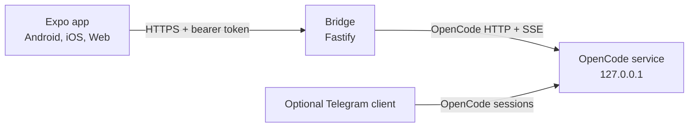

# OpenCode Mobile

An unofficial phone and web client for [OpenCode](https://github.com/anomalyco/opencode), built around a small authenticated bridge that runs next to your existing OpenCode service.

[](LICENSE)
[](docs/development.md)
[](https://nodejs.org/)
[](CHANGELOG.md)
[](.github/workflows/ci.yml)

**English** | [العربية](README.ar.md)

| Connect | Sessions | Chat | Question |
| --- | --- | --- | --- |
|  |  |  |  |

> Screenshots are placeholders until the device QA pass. Replace them with clean demo captures that contain no tokens, private paths, or real session titles.

## Why this exists

OpenCode runs on your machine, but you are not always at that machine. This project puts the parts that need a human on your phone: reading a streamed answer, answering an agent question, approving a tool permission, or attaching a file.

It does not run a second agent and it does not expose a terminal on the phone. The bridge is another authenticated client of the OpenCode service that is already running on the host.

## Features

- Connect to a local bridge over LAN or Tailscale with a bearer token.
- Session list with search, grouping, waiting state, refresh, create, rename, and delete.
- Chat transcript with streamed output, reconnect handling, older-message paging, and a latest-message control.
- Inline agent questions and permission approval, including destructive-action confirmation.
- Image, camera, and document attachments with upload retry and authenticated downloads.
- Tool activity summaries, diff view, and monochrome code highlighting.
- Dark and light themes, Arabic and English UI, mixed-direction text, and RTL layout.
- Optional Expo push notifications for finished turns, questions, and approvals.
- Expo Web build with an opt-in bridge origin allowlist (`CORS_ORIGINS`). Cross-origin access stays disabled by default.

Not implemented yet: model or agent switching, per-session model selection, a built-in Telegram bot, and a native desktop wrapper. The app does receive a `telegram` source label when another OpenCode client is used.

## How it works



The bridge discovers the local OpenCode service, authenticates to it, and maps its HTTP/SSE events to a smaller REST and WebSocket surface for the app. It also stores the upload registry and optional push registrations. It is not a second agent and does not modify OpenCode itself.

See [docs/architecture.md](docs/architecture.md) for the component and event flow.

## Requirements and compatibility

| Component | Requirement |
| --- | --- |
| OpenCode | Verified with `2.0.24` in October 2026. The API may change between OpenCode releases. |
| Node.js | `22.13` or newer; Node 24 LTS is recommended. |
| npm | 10 or newer. |
| Expo | SDK 58 / React Native 0.88. |
| Android | API 24 or newer. Release APKs, when published, are arm64 only. |
| iOS | Build with Expo/EAS on macOS. This repository does not produce an iOS binary in CI. |
| Web | Current Chromium, Firefox, or Safari. Web uses `sessionStorage` for the token. Add the app origin to `CORS_ORIGINS`; prefer a same-origin proxy for public deployments. |
| Network | Loopback on the host, plus Tailscale or another private tunnel for the phone. |

Pin the versions in `app/package-lock.json` and `bridge/package-lock.json`. Do not assume that a newer OpenCode release keeps the same HTTP or event shape.

## Quick start

### 1. Start OpenCode

```bash
opencode service start
```

The bridge finds the service through `~/.local/state/opencode/service.json`. You can also set `OPENCODE_URL` and `OPENCODE_PASSWORD` explicitly. The URL must be loopback.

### 2. Run the bridge

```bash
cd bridge
npm ci
cp .env.example .env
openssl rand -hex 32
# Put the generated value in AUTH_TOKEN.
# Set ALLOWED_WORKDIRS to the project roots you want to allow.
npm run build
npm start
```

The bridge listens on `127.0.0.1:8787` by default.

### 3. Verify the bridge

```bash
curl http://127.0.0.1:8787/health
# {"ok":true}
```

### 4. Run the app

```bash
cd app
npm ci
npx expo start
```

For a browser preview:

```bash
npm run web
```

The web build is a first-class client, but the bridge only accepts browser
requests from origins you list explicitly. Add the Expo web origin to
`bridge/.env` before starting the bridge:

```dotenv
CORS_ORIGINS=http://localhost:8081,http://127.0.0.1:8081
```

CORS controls browser reads; it is not authentication. The bearer token is still
required, and a production deployment should serve the app and bridge behind the
same origin so the token is not exposed to unrelated pages.

When a signed APK is published, it will be attached to a GitHub Release. The current local builds are for sideloading and are not Play Store releases.

### 5. Connect

On the first screen, enter the bridge URL and the same `AUTH_TOKEN` value. On a phone, use a reachable private address such as a Tailscale address, not `127.0.0.1` from the host.

## Remote access

The safe default is loopback plus Tailscale:

```bash
tailscale serve --bg http://127.0.0.1:8787
```

Then enter the resulting `https://<machine>.<tailnet>.ts.net` URL in the app. An SSH tunnel also works for a laptop-based preview.

A Cloudflare Tunnel can work for a short-lived demo, but it puts the bridge behind a public hostname. The token is the only gate. For anything longer than a demo, use Tailscale and keep `HOST=127.0.0.1`.

Do not bind the bridge to `0.0.0.0` and expose the port directly to the internet.

## Security model

The short version: **the bridge token is a shell credential for your machine.** Anyone who has it can ask the agent to read files, run commands, and change code in the allowed workdirs.

What is implemented:

- Bearer-token authentication for REST and WebSocket access.
- Constant-time token comparison, failed-auth bans, and request rate limits.
- Upload type and extension allowlists, size caps, filename sanitization, and storage inside `ALLOWED_WORKDIRS`.
- Authenticated downloads with `nosniff` and attachment disposition.
- Redacted logs for authorization headers, cookies, and query tokens.
- Tokens stored in SecureStore on native; the web preview uses `sessionStorage`.

What is not protected:

- There is one shared token and no per-user authorization.
- There is no end-to-end encryption between the app and the bridge.
- Native builds allow cleartext HTTP for local and Tailscale connections.
- The WebSocket accepts a query token on `/ws`; it can appear in proxy or tunnel logs.
- Existing OpenCode sessions outside `ALLOWED_WORKDIRS` may still be readable through the OpenCode API.
- Optional push notifications go through Expo's push service. Payloads contain IDs and generic text, not message bodies.

Rotate `AUTH_TOKEN` if it was ever shared, logged, or captured in a screenshot. Keep the bridge on a private network. See [SECURITY.md](SECURITY.md) and [docs/security.md](docs/security.md).

## Configuration

| Variable | Default | Description |
| --- | --- | --- |
| `PORT` | `8787` | Bridge HTTP port. |
| `HOST` | `127.0.0.1` | Bind address. Keep loopback. |
| `AUTH_TOKEN` | required | Shared bearer token. At least 32 characters. |
| `OPENCODE_URL` | discovered | Optional explicit OpenCode URL. Must be loopback. |
| `OPENCODE_PASSWORD` | discovered | Password for an explicit OpenCode URL. |
| `ALLOWED_WORKDIRS` | home directory | Comma-separated roots allowed for sessions and uploads. Set this narrowly. |
| `CORS_ORIGINS` | empty | Exact browser origins allowed to call the bridge. Empty disables CORS. Wildcards and paths are rejected. |
| `MAX_UPLOAD_MB` | `25` | Per-file limit. |
| `MAX_UPLOAD_TOTAL_MB` | `100` | Per-request total upload limit. |
| `MAX_FILES_PER_MESSAGE` | `10` | Attachment count limit. |
| `ALLOWED_UPLOAD_TYPES` | built-in list | Comma-separated MIME types and extensions. |
| `DATA_DIR` | `./data` | Upload registry, push registrations, and local state. |
| `BAN_AFTER` | `10` | Failed auth attempts before a temporary ban. |
| `BAN_MINUTES` | `15` | Ban duration. |
| `RATE_LIMIT_PER_MINUTE` | `180` | Request limit per minute. |
| `LOG_LEVEL` | `info` | Pino log level. |
| `PUSH_ENABLED` | `1` | Set to `0` to disable Expo push registration. |

## Project structure

```text
opencode-mobile/
  app/                 Expo Router client
  bridge/              Fastify bridge
  shared/              Shared REST and WebSocket types
  docs/                Architecture, security, development, web, API notes
  deploy/              Docker, systemd, Caddy, and operations guide
  website/             Static landing page
  scripts/             Web export patch and Android SDK/APK helpers
  .github/             CI, Pages, issue templates, and automation
  ROADMAP.md           Milestones and open decisions
  README.md            English README
  README.ar.md         Arabic README
  LICENSE              MIT
  THIRD_PARTY_NOTICES.md
```

## Development

```bash
npm run install:app
npm run install:bridge
npm run check
```

`npm run check` runs the app typecheck, the app lint, the bridge typecheck, and the bridge tests.

Useful commands:

```bash
npm run dev:bridge       # bridge in watch mode
npm run dev:app          # Expo dev server
npm run build:bridge     # compile the bridge to bridge/dist
cd app && npm run web:export
```

Android builds are easier with EAS. For a local build, generate the native project first:

```bash
cd app
npx expo prebuild --platform android
```

Then use Android Studio, or on Linux run `scripts/bootstrap-android-sdk.sh` and `scripts/build-apk.sh`. The helper scripts are optional and assume a generated `app/android` directory.

See [docs/development.md](docs/development.md) for Linux, macOS, Windows, WSL2, EAS, and server notes. See [docs/release.md](docs/release.md) for versioning, signed APKs, bundles, and checksums.

## Testing

```bash
cd bridge
npm test
npm run build

cd ../app
npx tsc --noEmit
npm run lint
npx expo export --platform web
```

The bridge tests cover config, auth, uploads, WebSocket routing, mapping, and state. The app does not yet have an automated UI test suite; device QA is tracked in the roadmap.

## Contributing

Read [CONTRIBUTING.md](CONTRIBUTING.md). Small, focused pull requests are preferred. Run `npm run check` before opening a PR.

## Troubleshooting

- **`401 unauthorized`** — the token in the app does not match `AUTH_TOKEN`. Re-copy it and reconnect.
- **Cannot reach the bridge** — `HOST` is probably loopback. Use Tailscale, `tailscale serve`, or an SSH tunnel. Check the port and firewall.
- **Uploads rejected** — check the file type, per-file size, total size, file count, and that the session workdir is inside `ALLOWED_WORKDIRS`.
- **Questions or approvals do not appear** — confirm the WebSocket is connected and the app is in the foreground. Check the OpenCode version; event names can change.
- **Push is unavailable** — it needs an EAS `projectId`, a physical device, and notification permission.
- **The token disappears on web refresh** — by design. The web preview uses `sessionStorage`; native builds use SecureStore.
- **Android blocks cleartext HTTP** — the app allows it for local/Tailscale use. Do not use a public HTTP bridge.
- **`npm ci` fails** — use Node 22.13 or newer and the committed lockfiles.

More detail is in [docs/troubleshooting.md](docs/troubleshooting.md).

## Roadmap

The detailed plan, acceptance criteria, and open decisions are in
[ROADMAP.md](ROADMAP.md).

Published:

- Source: <https://github.com/Aetherdz/opencode-mobile>
- Terminal installers: <https://github.com/Aetherdz/opencode-mobile-dist>
- Website: <https://aetherdz.github.io/opencode-mobile/>
- Bridge and web beta bundles with SHA-256 checksums in GitHub Releases.

Still open:

- A release-signed Android APK and a device QA pass.
- A neutral icon and a final trademark position.
- Model and agent switching through the bridge.
- iOS TestFlight and a desktop wrapper decision.

## License

MIT. See [LICENSE](LICENSE).

## Disclaimer

This is an unofficial community project. It is not affiliated with, endorsed by, or supported by the OpenCode team. OpenCode, Expo, React, Tailscale, Cloudflare, and Telegram are names of their respective owners. No third-party logo is used as a claim of endorsement.

## Acknowledgements

- [OpenCode](https://github.com/anomalyco/opencode) for the agent and local API.
- [Expo](https://expo.dev) and [React Native](https://reactnative.dev) for the client stack.
- The Inter, Noto Sans Arabic, and JetBrains Mono projects for the typefaces.
- [Ionicons](https://ionic.io/ionicons) for the icon set.
