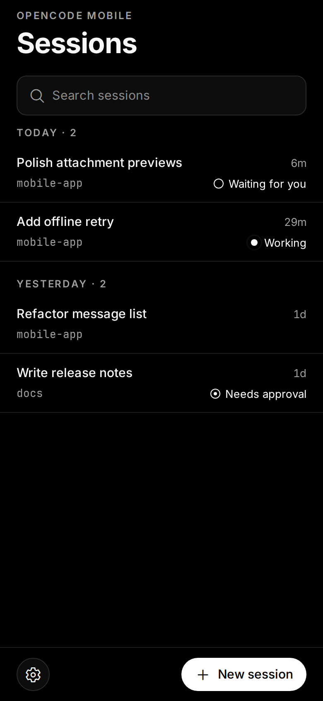
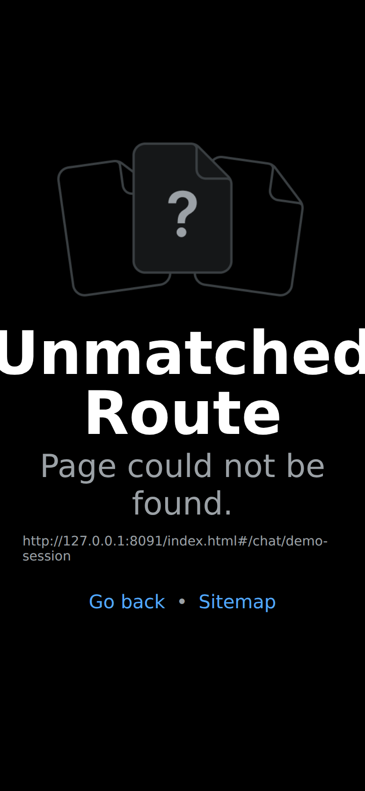
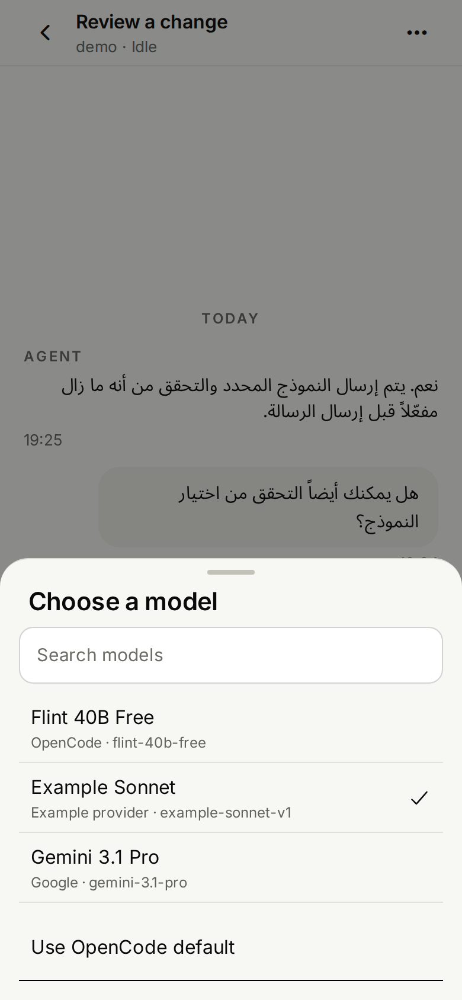
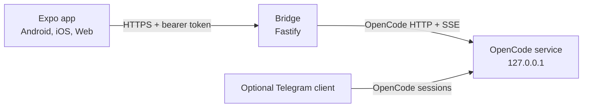

<div align="center">

# OpenCode Mobile

**Your agent. Your machine. Your pocket.**

An unofficial mobile and web client for the [OpenCode](https://github.com/anomalyco/opencode) coding agent.
Self-hosted, token-authenticated, and built for the moments when you are away
from the keyboard but still need to answer the agent.

[Website](https://aetherdz.github.io/opencode-mobile/) ·
[Install](https://aetherdz.github.io/opencode-mobile/#install) ·
[Docs](https://aetherdz.github.io/opencode-mobile/docs/) ·
[Releases](https://github.com/Aetherdz/opencode-mobile/releases) ·
[Repository docs](docs/) ·
[العربية](README.ar.md)

[](https://github.com/Aetherdz/opencode-mobile/stargazers)
[](https://github.com/Aetherdz/opencode-mobile/releases)
[](https://github.com/Aetherdz/opencode-mobile/actions/workflows/ci.yml)
[](LICENSE)

</div>

## What it is

OpenCode runs on your machine. OpenCode Mobile puts the human parts of the
workflow on your phone: reading a streamed answer, answering an agent question,
approving a tool, attaching a file, or checking a diff.

It does **not** run a second agent and it does **not** expose a terminal on the
phone. A small authenticated bridge connects the app to the OpenCode service
that is already running on your host.

## Screens (synthetic demo data)

These are screenshots rendered by the current Expo web app against a local
mock API with synthetic data. They show the actual app UI, not native-device
captures or a live account.

| Demo sessions | Demo chat | Demo model picker |
| --- | --- | --- |
|  |  |  |

The connection screen accepts the QR payload printed by `opencode-mobile` or
its `opencode-mobile://connect` app link. It only fills the connection fields;
you must review them and tap Connect before credentials are saved. Manual URL
and token entry remain available.

## Features

- Connect over LAN or Tailscale with one bearer token.
- Session list with search, grouping, waiting state, refresh, create, rename, and delete.
- Streamed chat with reconnect handling, older-message paging, and a latest-message control.
- Inline agent questions and permission approval, including destructive-action confirmation.
- Image, camera, and document attachments with upload retry and authenticated downloads.
- Tool activity summaries, diff view, and monochrome code highlighting.
- Dark and light themes, English and French UI, with mixed-direction text support.
- Message direction follows its content (English LTR, Arabic RTL), regardless of app locale; verified on Expo Web. Native RTL behavior remains unverified.
- Optional Expo push notifications for finished turns, questions, and approvals.
- Expo Web build with an opt-in bridge origin allowlist (`CORS_ORIGINS`).

The bottom composer toolbar places model switching beside the attachment
control. It uses the enabled model catalog from OpenCode; the choice is stored
locally on the device and applies to new messages across chats. Agent switching,
per-session model selection, a built-in Telegram bot, and a native desktop
wrapper are not implemented. The app does receive a
`telegram` source label when another OpenCode client is used.

## Quick start

### One-time host setup (Linux/macOS)

One-command setup (Linux/macOS): this fetches `main` from the [distribution installer](https://github.com/Aetherdz/opencode-mobile-dist), so it trusts that branch:

```bash
installer="$(mktemp)"
trap 'rm -f "$installer"' EXIT
curl -fsSL https://raw.githubusercontent.com/Aetherdz/opencode-mobile-dist/main/install.sh -o "$installer"
bash "$installer" setup
```

After setup, run `opencode-mobile` once to pair the phone. On Linux with an
active Tailscale connection it offers persistent, private Tailscale Serve by
default; on other hosts, the temporary public tunnel requires explicit consent.
See the distribution README for lifecycle and platform limitations.

The command above downloads the installer to a temporary file before running
it. It trusts GitHub `main`; for higher assurance, pin and inspect a commit.
Bridge release assets are verified against `SHA256SUMS` after download. Do not
pipe the installer into `bash`.

`setup` verifies the bridge release against `SHA256SUMS`, prompts for a
project directory, preserves an existing token/config, and keeps the bridge on
`127.0.0.1`. On Linux with `systemd --user`, it starts the bridge at user login.
`opencode-mobile` checks OpenCode and bridge health, then prefers private,
persistent Tailscale Serve when available. Pair the app with its tailnet URL and
token once; the saved connection works while both devices are on the tailnet.
The public temporary Cloudflare tunnel remains an explicit-consent alternative.
`down`, `status`, `doctor`, and `apk` are available. The current
APK is arm64-v8a only; `apk` verifies and displays its URL/checksum and does not
install with adb without interactive approval. See the installer README for
supported host architectures and setup limitations.

The app starts in English; language preferences are available in Settings.

### 1. Start OpenCode

```bash
opencode service start
```

The bridge discovers the local service through
`~/.local/state/opencode/service.json`. You can also set `OPENCODE_URL` and
`OPENCODE_PASSWORD` explicitly; the URL must be loopback.

### 2. Run the bridge

```bash
cd bridge
npm ci
cp .env.example .env
openssl rand -hex 32   # put this in AUTH_TOKEN
npm run build
npm start
```

Set `ALLOWED_WORKDIRS` to the project roots you want to expose. The bridge
listens on `127.0.0.1:8787` by default.

```bash
curl http://127.0.0.1:8787/health
# {"ok":true}
```

### 3. Run the app

```bash
cd app
npm ci
npx expo start
```

For the browser build, use `npm run web` and add the Expo origin to
`bridge/.env`:

```dotenv
CORS_ORIGINS=http://localhost:8081,http://127.0.0.1:8081
```

CORS controls browser reads; it is not authentication. The bearer token is
still required.

On the first screen, enter the bridge URL and the same `AUTH_TOKEN`. On a phone,
use a reachable private address such as a Tailscale address, not
`127.0.0.1` from the host.

## Download

Beta.4 and beta.5 have been withdrawn. The replacement **`1.0.0-beta.6`** is a
test build with the reported fixes; please verify it on your device before
relying on it. The website card remains on beta.3 pending owner testing. The
signed Android APK targets arm64-v8a.

| Artifact | Notes |
| --- | --- |
| [Android APK](https://github.com/Aetherdz/opencode-mobile/releases/download/v1.0.0-beta.6/opencode-mobile-1.0.0-beta.6.apk) | [SHA-256 file](https://github.com/Aetherdz/opencode-mobile/releases/download/v1.0.0-beta.6/opencode-mobile-1.0.0-beta.6.apk.sha256); arm64-v8a |
| [Bridge bundles](https://github.com/Aetherdz/opencode-mobile/releases/tag/v1.0.0-beta.6) | `.tar.gz` and `.zip`, with `SHA256SUMS` |
| [Web bundles](https://github.com/Aetherdz/opencode-mobile/releases/tag/v1.0.0-beta.6) | Static Expo export, with `SHA256SUMS` |
| [Installers](https://github.com/Aetherdz/opencode-mobile-dist) | Linux, macOS, and Windows bridge installer |

The beta is not on Google Play. iPhone builds require macOS/EAS and are not
produced by CI.

## How it works



The bridge discovers the local OpenCode service, authenticates to it, and maps
its HTTP/SSE events to a smaller REST and WebSocket surface for the app. It
stores the upload registry and optional push registrations. It is not a second
agent and does not modify OpenCode itself.

See [docs/architecture.md](docs/architecture.md) for the component and event
flow.

## Security model

The short version: **the bridge token is a shell credential for your machine.**
Anyone who has it can ask the agent to read files, run commands, and change code
in the allowed workdirs.

Implemented:

- Bearer-token authentication for REST and WebSocket access.
- Constant-time token comparison, failed-auth bans, and request rate limits.
- Authentication before body parsing; `/health` is the only unauthenticated route.
- Upload type and extension allowlists, size caps, filename sanitization, and storage inside `ALLOWED_WORKDIRS`.
- Authenticated downloads with `nosniff`, `X-Frame-Options: DENY`, and attachment disposition.
- Redacted logs for authorization headers, cookies, query tokens, and raw paths.
- Tokens stored in SecureStore on native; the web preview uses `sessionStorage`.
- Release APKs signed with a project keystore; the certificate is checked in CI.

Not protected:

- There is one shared token and no per-user authorization.
- There is no end-to-end encryption between the app and the bridge.
- Native builds allow cleartext HTTP for local and Tailscale connections.
- The WebSocket upgrade uses a short-lived one-time ticket; do not log query strings.
- Session metadata outside `ALLOWED_WORKDIRS` may still appear in the session list, but content, prompts, approvals, diffs, uploads, and stop/delete actions are rejected.
- Optional push notifications go through Expo's push service. Payloads contain IDs and generic text, not message bodies.

Rotate `AUTH_TOKEN` if it was ever shared, logged, or captured in a screenshot.
Keep the bridge on a private network. See [SECURITY.md](SECURITY.md) and
[docs/security.md](docs/security.md).

## Configuration

| Variable | Default | Description |
| --- | --- | --- |
| `AUTH_TOKEN` | required | Shared bearer token. At least 32 characters. |
| `HOST` | `127.0.0.1` | Bind address. Keep loopback. |
| `PORT` | `8787` | Bridge HTTP port. |
| `ALLOWED_WORKDIRS` | home directory | Comma-separated roots allowed for sessions and uploads. Set this narrowly. |
| `CORS_ORIGINS` | empty | Exact browser origins allowed to call the bridge. Empty disables CORS. |
| `MAX_UPLOAD_MB` | `25` | Per-file limit. |
| `MAX_UPLOAD_TOTAL_MB` | `100` | Per-request total upload limit. |
| `MAX_FILES_PER_MESSAGE` | `10` | Attachment count limit. |
| `PUSH_ENABLED` | `1` | Set to `0` to disable Expo push registration. |

The full list, defaults, and deployment notes are in
[`bridge/.env.example`](bridge/.env.example) and
[deploy/README.md](deploy/README.md).

## Remote access

The safe default is loopback plus Tailscale:

```bash
tailscale serve --bg http://127.0.0.1:8787
```

Then enter the resulting `https://<machine>.<tailnet>.ts.net` URL in the app. An
SSH tunnel also works for a laptop-based preview.

### Temporary Cloudflare tunnel security

The optional quick tunnel creates a **publicly reachable HTTPS hostname** that
forwards to the bridge on loopback. HTTPS encrypts traffic in transit; it does
not make the hostname private. The shared bearer token is the only access gate,
and a token holder can control the agent within the configured workdirs. TLS
terminates at the tunnel provider, so this is not end-to-end private. Approve
the tunnel only for a short demo, do not share its URL and token together, keep
`ALLOWED_WORKDIRS` narrow, and run `opencode-mobile down` when finished. The
temporary URL is not saved and expires when its tunnel process stops; the Linux
service manages the bridge only, not tunnel recovery. Use Tailscale for routine
remote access and keep `HOST=127.0.0.1`.

Do not bind the bridge to `0.0.0.0` and expose the port directly to the
internet.

## Development

```bash
npm run install:app
npm run install:bridge
npm run check
```

`npm run check` runs the app typecheck, the app lint, the bridge typecheck, and
the bridge test suite (98 tests at the last verified run).

Useful commands:

```bash
npm run dev:bridge       # bridge in watch mode
npm run dev:app          # Expo dev server
npm run build:bridge     # compile the bridge to bridge/dist
npm run web:export       # static web export with PWA metadata
```

Android builds are easier with EAS. For a local build, generate the native
project first:

```bash
cd app
npx expo prebuild --platform android
```

Then use Android Studio, or on Linux run `scripts/bootstrap-android-sdk.sh` and
`scripts/build-apk.sh`. Release signing in CI is documented in
[docs/release.md](docs/release.md).

## Documentation

- [Architecture](docs/architecture.md) — components, event flow, data model.
- [Security](docs/security.md) — threat model, controls, known gaps.
- [Development](docs/development.md) — Linux, macOS, Windows, WSL2, EAS.
- [Web client](docs/web.md) — CORS, same-origin proxy, static hosting.
- [Release](docs/release.md) — versioning, signing, checksums, assets.
- [Troubleshooting](docs/troubleshooting.md) — common failures and fixes.
- [Roadmap](ROADMAP.md) — milestones and open decisions.

## Contributing

Read [CONTRIBUTING.md](CONTRIBUTING.md). Small, focused pull requests are
preferred. Run `npm run check` before opening a PR.

## License

MIT. See [LICENSE](LICENSE).

## Disclaimer

This is an unofficial community project. It is not affiliated with, endorsed
by, or supported by the OpenCode team. OpenCode, Expo, React, Tailscale,
Cloudflare, and Telegram are names of their respective owners. No third-party
logo is used as a claim of endorsement.

## Acknowledgements

- [OpenCode](https://github.com/anomalyco/opencode) for the agent and local API.
- [Expo](https://expo.dev) and [React Native](https://reactnative.dev) for the client stack.
- The Inter, Noto Sans Arabic, and JetBrains Mono projects for the typefaces.
- [Ionicons](https://ionic.io/ionicons) for the icon set.
