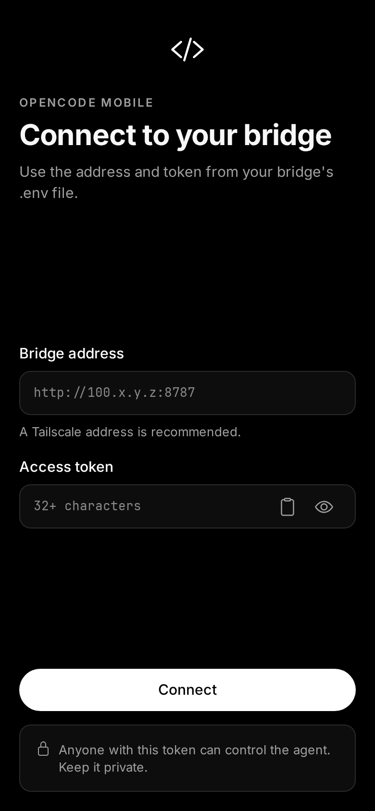
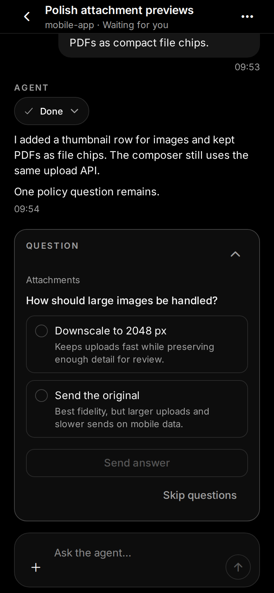
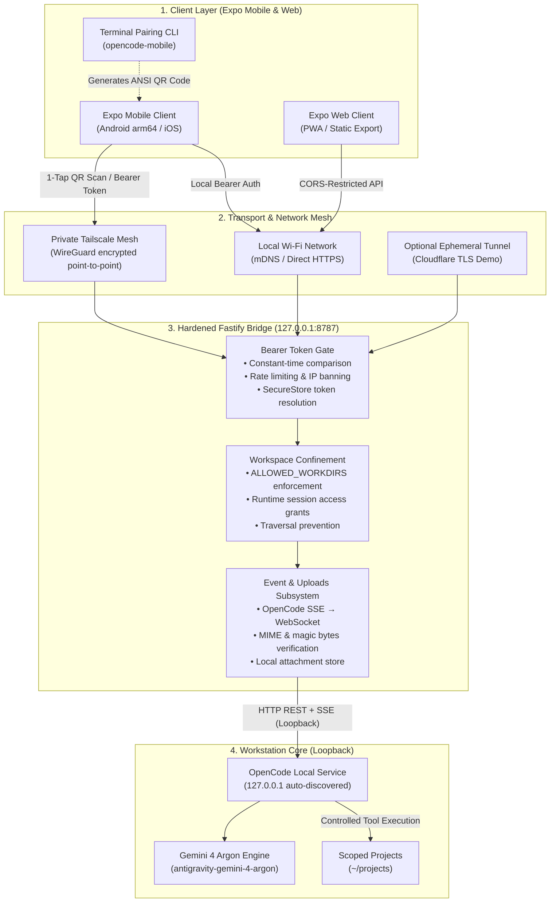

<div align="center">

# OpenCode Mobile

### *Your coding agent. Your machine. In your pocket.*

An unofficial mobile, tablet, and web client engineered for the [OpenCode](https://github.com/anomalyco/opencode) coding agent, powered by Google DeepMind's **Gemini 4 Argon** architecture. Self-hosted, end-to-end token authenticated, zero telemetry, and built for directing your development agent when away from your workstation.

[Website](https://aetherdz.github.io/opencode-mobile/) ·
[Install Guide](https://aetherdz.github.io/opencode-mobile/#install) ·
[Documentation](docs/) ·
[Architecture](docs/architecture.md) ·
[Security Model](docs/security.md) ·
[GitHub Releases](https://github.com/Aetherdz/opencode-mobile/releases) ·
[العربية (Arabic)](README.ar.md)

<br/>

[](https://github.com/Aetherdz/opencode-mobile/releases)
[](https://deepmind.google/)
[](https://github.com/Aetherdz/opencode-mobile/actions)
[](https://www.typescriptlang.org/)
[](https://expo.dev/)
[](https://fastify.dev/)
[](#security-and-privacy-model)
[](LICENSE)

</div>

<br/>

---

## What It Is

**OpenCode** runs directly on your development workstation or server with direct access to your local tools, git repositories, compilers, and language models. **OpenCode Mobile** extends that capability into your pocket.

It bridges the human interaction loop whenever you step away from the keyboard:
- ⚡ **Review streamed responses in real time** with Server-Sent Events (SSE) and live syntax highlighting.
- 💬 **Answer inline agent questions** with structured multi-choice chips and custom inputs.
- 🛡️ **Approve tool permissions** (file writes, shell execution, web fetches) with destructive-action confirmation.
- 🎴 **Manage workspaces** across multiple local repositories with tactile elevated session cards.
- 📎 **Attach visual context** by uploading camera photos, screenshots, and source documents directly into the active session.

> [!NOTE]
> OpenCode Mobile does **not** run a secondary agent in the cloud, and does **not** expose an unconstrained remote shell. It operates through a hardened, authenticated local Fastify bridge that binds exclusively to your loopback interface.

---

## Terminal Experience & 1-Command Setup

Getting started takes seconds. Install the bridge and interactive CLI with a single command:

```bash
curl -fsSL https://raw.githubusercontent.com/Aetherdz/opencode-mobile-dist/main/install.sh | bash
```

Once installed, simply invoke the CLI to generate your instant connection link and terminal QR code:

```bash
opencode-mobile
```

```text
╭──────────────────────────────────────────────────────────────╮
│  ✦ OpenCode Mobile · Quick Connect                           │
├──────────────────────────────────────────────────────────────┤
│  Bridge Service:    ● Online (Port 8787)                     │
│  OpenCode Agent:    ● Connected                              │
│  Connection Mode:   Secure Tailscale Serve / Local Loopback  │
│                                                              │
│  Connection URL:                                             │
│  https://workstation.tailnet.ts.net                          │
│                                                              │
│  Pairing Token:                                              │
│  e4b17a8c3d90f251a842de561c9b4e07... (32+ chars)            │
│                                                              │
│  Workdir: /home/developer/projects                           │
├──────────────────────────────────────────────────────────────┤
│  ▄▄▄▄▄▄▄ ▄ ▄▄ ▄▄▄▄ ▄▄▄▄▄▄▄                                   │
│  █ ▄▄▄ █ █▄█ █▄███ █ ▄▄▄ █   1-Tap QR Auto-Connect:          │
│  █ ███ █ ▄▀█▄█▀▄ █ █ ███ █   Point camera at this QR code    │
│  █▄▄▄▄▄█ █ █ █ █ █ █▄▄▄▄▄█   to pair credentials instantly   │
│  ▄▄ ▄  ▄▄▀▄▀▄▀▄▄██▄▄  ▄ ▄▄   without manual typing!          │
│  █▄▄▄▄▄█ █▀▀██▄▀ █ █ ▄ █▄█                                   │
│  ▀▀▀▀▀▀▀ ▀   ▀▀▀▀▀ ▀▀▀  ▀▀                                   │
├──────────────────────────────────────────────────────────────┤
│  Scan with OpenCode Mobile camera to pair immediately.       │
│  Press Ctrl+C to disconnect at any time.                     │
╰──────────────────────────────────────────────────────────────╯
```

---

## Visual Showcase (Screenshots Gallery)

The user interface is crafted with precision, native fluid physics, high-contrast dark and light modes, and full bidirectional Arabic/English support:

| 1. Auto-Connect | 2. Elevated Sessions | 3. Streamed Chat | 4. Argon 4 Model Picker | 5. Inline Questions |
| :---: | :---: | :---: | :---: | :---: |
|  |  |  |  |  |
| **Instant QR Auto-Connect**<br/>One-tap camera scan & smart clipboard detection | **Elevated Session Cards**<br/>Tactile scaling physics, status dots, and grouping | **Streamed Chat & Diffs**<br/>Live SSE updates, collapsible diffs, code highlight | **Argon 4 High Reasoning**<br/>Dynamic model catalog & instant switching | **Agent Question Prompts**<br/>Inline multi-choice options & safety approvals |

---

## Core Architecture

OpenCode Mobile is architectured around a defense-in-depth model that connects your mobile device directly to your workstation without third-party intermediary servers:



### Architectural Highlights

1. **Gemini 4 Argon High-Reasoning Engine**: Built-in support for the `antigravity-gemini-4-argon` model family. OpenCode Mobile automatically detects local model configurations via `readConfiguredModels` and provides seamless runtime model selection directly in the bottom composer.
2. **1-Tap QR Auto-Connect**: The CLI outputs an encrypted `opencode-mobile://connect` pairing payload embedded into an ANSI terminal QR code. Scanning with the app immediately verifies the connection and saves credentials without manual keying.
3. **Elevated Session Cards**: Session rows feature continuous corner curves, micro-scale press animations, clear status indicators (idle, active turn, waiting for answer), and comprehensive session management (search, create, rename, delete).
4. **Scoped Directory Access**: Out-of-the-box isolation confining agent activity strictly to `ALLOWED_WORKDIRS` (`~/projects`). Out-of-bounds repositories require explicit 1-tap runtime authorization grants via native dialogs.
5. **Zero Telemetry Guarantee**: No tracking libraries, no Firebase analytics, no external crash reporting. All communication flows directly over private network tunnels.

---

## Quick Start

### Option A: Automated CLI Setup (Recommended)

1. **Install with one command** (Linux / macOS):
   ```bash
   curl -fsSL https://raw.githubusercontent.com/Aetherdz/opencode-mobile-dist/main/install.sh | bash
   ```
2. **Pair with your mobile device**:
   ```bash
   opencode-mobile
   ```
   Point your phone's camera at the terminal QR code to connect instantly.

Available CLI operations:
```bash
opencode-mobile status   # Verify bridge and agent health
opencode-mobile doctor   # Diagnose network and permission issues
opencode-mobile down     # Safely terminate active bridge and tunnels
opencode-mobile apk      # Download and verify the signed Android APK
```

### Option B: Manual Source Setup

If you prefer building and running directly from source:

#### 1. Start OpenCode
```bash
opencode service start
```
The bridge automatically discovers the service via `~/.local/state/opencode/service.json`.

#### 2. Run the Bridge
```bash
cd bridge
npm ci
cp .env.example .env
openssl rand -hex 32   # Place this value in AUTH_TOKEN
npm run build
npm start
```
Verify the bridge health endpoint:
```bash
curl http://127.0.0.1:8787/health
# {"ok":true}
```

#### 3. Run the App
```bash
cd app
npm ci
npx expo start
```
For web browser preview:
```bash
npm run web
```
*(Add `CORS_ORIGINS=http://localhost:8081` to your `bridge/.env` when accessing from a browser).*

---

## Configuration & Environment Variables

The bridge is configured via environment variables or a `bridge/.env` file:

| Variable | Default | Required | Description & Security Implications |
| :--- | :--- | :---: | :--- |
| `AUTH_TOKEN` | *None* | **Yes** | Shared secret bearer token. Must be **at least 32 characters** with high entropy. Treat this token as a shell credential. |
| `HOST` | `127.0.0.1` | No | Network bind interface. **Always keep loopback**. Exposing the bridge on `0.0.0.0` without network-level authentication is strictly prohibited. |
| `PORT` | `8787` | No | HTTP and WebSocket listening port for the bridge. |
| `ALLOWED_WORKDIRS` | `~/projects` | No | Comma-separated list of filesystem roots permitted for session discovery and file uploads. Set this as narrowly as possible. |
| `CORS_ORIGINS` | *Empty* | No | Comma-separated exact browser origins allowed to access the bridge (e.g. `http://localhost:8081`). Empty disables browser CORS entirely. |
| `MAX_UPLOAD_MB` | `25` | No | Maximum file size allowed for individual file uploads in megabytes. |
| `MAX_UPLOAD_TOTAL_MB` | `100` | No | Maximum cumulative upload size allowed per message in megabytes. |
| `MAX_FILES_PER_MESSAGE`| `10` | No | Maximum number of file attachments allowed in a single message turn. |
| `ALLOWED_UPLOAD_TYPES` | *Built-in* | No | Comma-separated MIME types and extensions allowed for upload. Malicious executables are blocked by default. |
| `DATA_DIR` | `./data` | No | Local directory used for attachment metadata registries and push notification records. |
| `BAN_AFTER` | `10` | No | Consecutive failed authentication attempts before an IP address is temporarily banned. |
| `BAN_MINUTES` | `15` | No | Duration in minutes for temporary IP bans triggered by repeated authentication failures. |
| `RATE_LIMIT_PER_MINUTE`| `180` | No | Maximum number of HTTP requests allowed per minute per client IP address. |
| `LOG_LEVEL` | `info` | No | Pino logger verbosity level (`fatal`, `error`, `warn`, `info`, `debug`, `trace`). Authorization headers are strictly redacted. |
| `PUSH_ENABLED` | `1` | No | Set to `1` to enable Expo push notifications, or `0` to completely disable push registration. |
| `OPENCODE_URL` | *Auto* | No | Explicit loopback URL for the OpenCode service. Auto-detected from `service.json` if omitted. |
| `OPENCODE_PASSWORD` | *Auto* | No | Basic auth password for the OpenCode service. Auto-detected if omitted. |

---

## Security and Privacy Model

OpenCode Mobile adheres to strict security defaults designed to protect your host machine:

### 1. Zero Telemetry & Data Sovereignty
- No third-party analytics SDKs, tracking pixels, or remote telemetry servers exist in the codebase.
- Session messages, code diffs, prompts, and tokens never touch external clouds.
- Communication remains strictly peer-to-peer over your local Wi-Fi or private WireGuard-encrypted Tailscale network.

### 2. Workspace Confinement & Safe Grants
- The bridge strictly enforces directory boundaries within `ALLOWED_WORKDIRS`.
- Sessions referencing outside repositories cannot be queried or manipulated until you explicitly grant individual runtime access via an interactive dialog in the app.
- Path traversal sequences (`../`) in uploads and session calls are sanitized and rejected.

### 3. Hardened Authentication & Rate Limiting
- Every REST endpoint (except `/health`) and WebSocket connection requires a valid Bearer token.
- Token validation is executed via `crypto.timingSafeEqual` to eliminate timing attacks.
- IPs triggering more than 10 failed authentication attempts are banned automatically for 15 minutes.
- WebSocket upgrades utilize single-use ephemeral tickets to prevent credential leakage in proxy access logs.

### 4. Credential Storage
- Mobile clients store connection tokens exclusively inside device-encrypted hardware keystores (`Expo SecureStore` / iOS Keychain / Android KeyStore).
- Web browser previews store tokens strictly in ephemeral `sessionStorage` (purged on tab close).

---

## Remote Access Options

### Recommended: Private Tailscale Mesh
The safest remote connectivity method is using [Tailscale](https://tailscale.com):
```bash
tailscale serve --bg http://127.0.0.1:8787
```
This produces an encrypted private URL (`https://<workstation>.<tailnet>.ts.net`) accessible only from devices on your private tailnet.

### Ephemeral Cloudflare Quick Tunnel (Demo Only)
For rapid temporary sharing, `opencode-mobile` provides an optional Cloudflare tunnel:
- Generates a temporary public HTTPS hostname forwarding to loopback.
- Access remains protected by your shared Bearer token.
- TLS terminates at Cloudflare; terminate immediately with `opencode-mobile down` when finished.

---

## Downloads

**`v1.0.0-beta.10`** is the current release.

| Artifact | Architecture / Platform | Checksum Verification |
| :--- | :--- | :--- |
| [Android APK (arm64-v8a)](https://github.com/Aetherdz/opencode-mobile/releases/download/v1.0.0-beta.10/opencode-mobile-1.0.0-beta.10.apk) | Android 7.0+ (API 24+) | [SHA-256 Checksum](https://github.com/Aetherdz/opencode-mobile/releases/download/v1.0.0-beta.10/opencode-mobile-1.0.0-beta.10.apk.sha256) |
| [Bridge Bundle (.tar.gz)](https://github.com/Aetherdz/opencode-mobile/releases/tag/v1.0.0-beta.10) | Node.js >=22.13 (Linux/macOS/Win) | [SHA256SUMS](https://github.com/Aetherdz/opencode-mobile/releases/tag/v1.0.0-beta.10) |
| [Web Static Export (.zip)](https://github.com/Aetherdz/opencode-mobile/releases/tag/v1.0.0-beta.10) | Modern Browsers (PWA ready) | [SHA256SUMS](https://github.com/Aetherdz/opencode-mobile/releases/tag/v1.0.0-beta.10) |
| [Distribution Installer](https://github.com/Aetherdz/opencode-mobile-dist) | Linux, macOS, Windows | Verified via `SHA256SUMS` |

---

## Development & Testing

```bash
# Install dependencies
npm run install:app
npm run install:bridge

# Run full test & lint verification suite
npm run check
```

The verification suite enforces zero errors across:
- **App Typecheck**: `tsc --noEmit` across Expo app codebase.
- **Bridge Typecheck**: `tsc --noEmit` across Fastify bridge codebase.
- **ESLint**: Strict linting rules across React Native components.
- **Vitest Unit Suite**: 107 automated unit and integration tests for auth, uploads, SSE/WebSocket mappings, and session confinement.
- **CLI Suite**: 4 unit tests covering installer integrity, token generation, and workdir sanitization.

### Build Commands
```bash
npm run dev:bridge       # Run Fastify bridge in live reload mode
npm run dev:app          # Launch Expo development server
npm run build:bridge     # Compile bridge TypeScript to bridge/dist
npm run web:export       # Export static production PWA build to app/dist
node scripts/check-site.mjs # Verify website documentation integrity
```

---

## Documentation Index

- [Architecture Guide](docs/architecture.md) — System layers, event flow, and protocol specifications.
- [Security Model](docs/security.md) — Threat model, security controls, and audit checklists.
- [Development Workflow](docs/development.md) — Host prerequisites, EAS builds, and platform nuances.
- [Web Client Guide](docs/web.md) — CORS configuration, reverse proxies, and PWA setup.
- [Release Process](docs/release.md) — Artifact signing, checksum generation, and version lifecycle.
- [Troubleshooting](docs/troubleshooting.md) — Diagnostic guides for connectivity, tokens, and permissions.
- [Project Roadmap](ROADMAP.md) — Milestone tracker and upcoming features.

---

## Contributing

Contributions are welcome! Please read [CONTRIBUTING.md](CONTRIBUTING.md) before submitting pull requests. All submissions must pass `npm run check` with zero warnings or errors.

---

## License

This project is licensed under the [MIT License](LICENSE).

---

## Disclaimer

OpenCode Mobile is an independent community-driven open-source project. It is not affiliated with, maintained by, or endorsed by the official OpenCode team. All brand names and trademarks belong to their respective owners.
