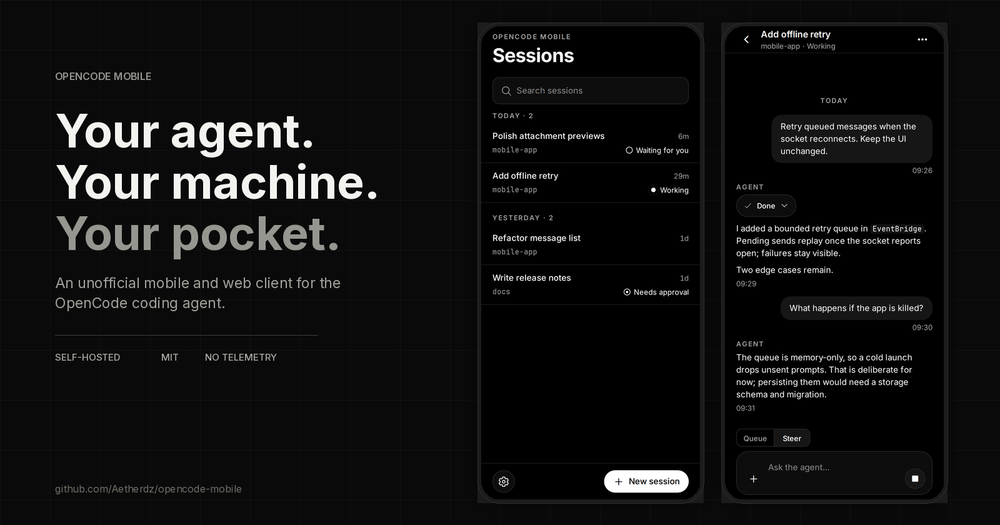
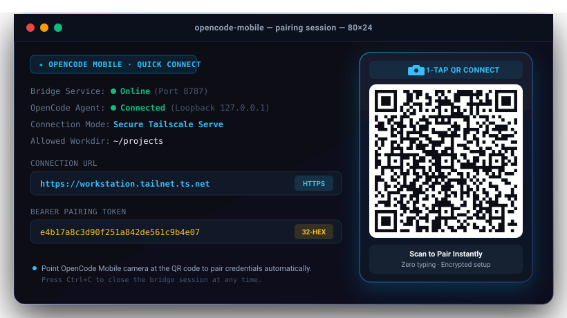
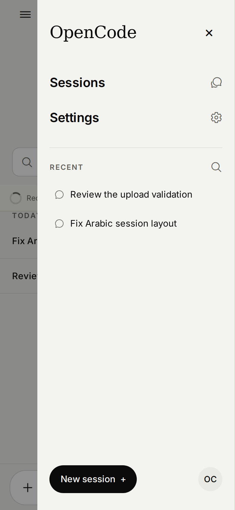
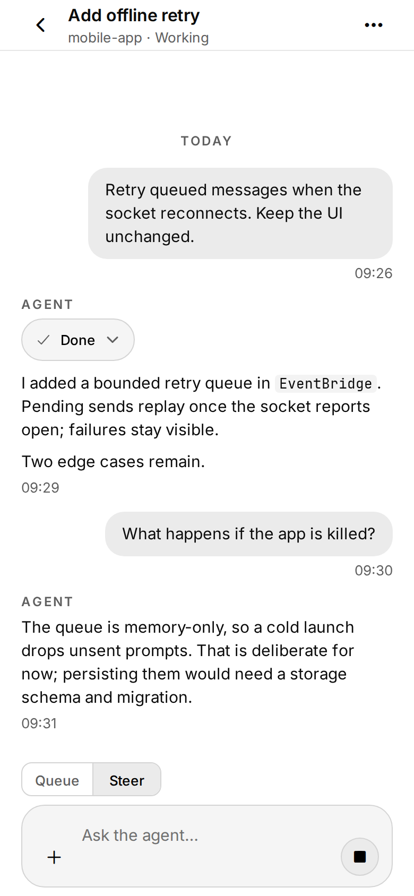
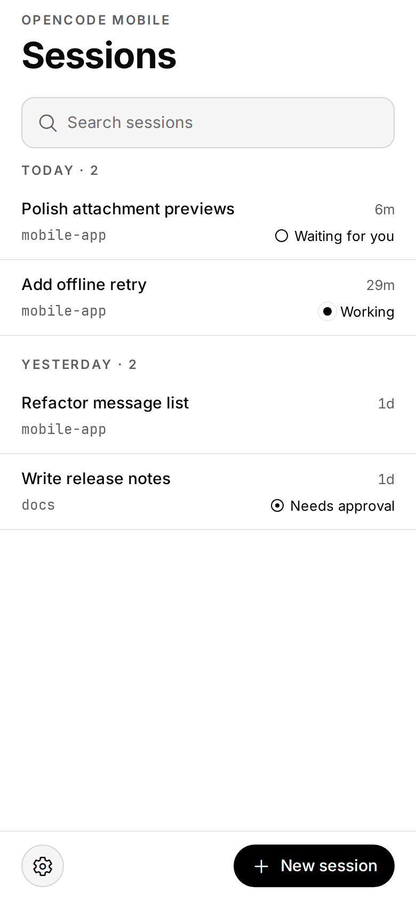
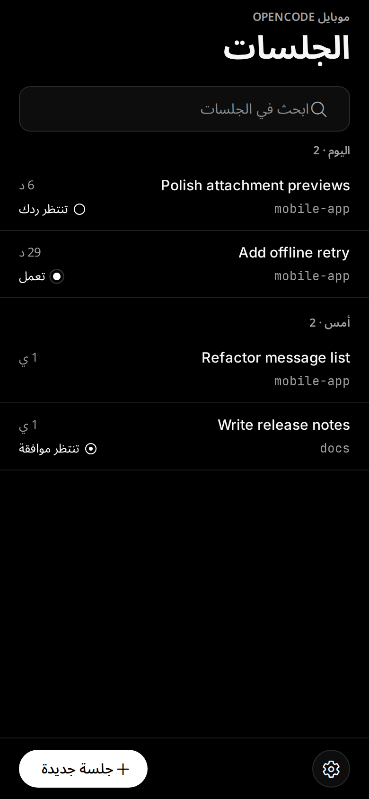
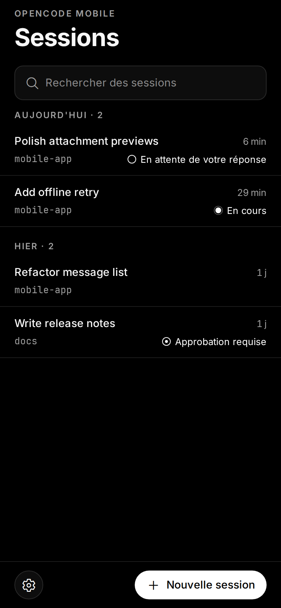
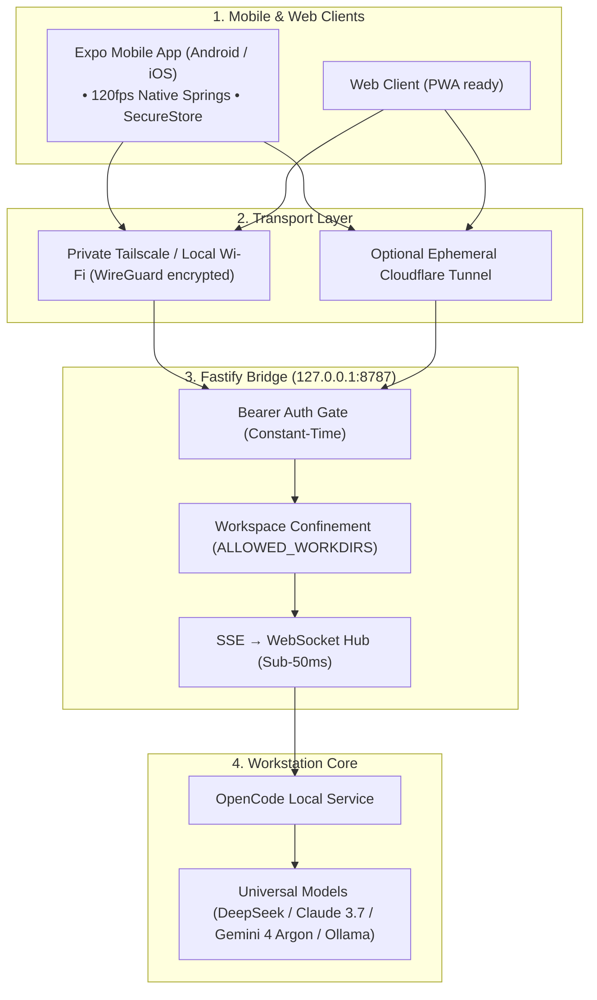

<div align="center">

# OpenCode Mobile

### *Your coding agent. Your machine. In your pocket.*

Unofficial 120fps fluid mobile & web client for the [OpenCode](https://github.com/anomalyco/opencode) coding agent with end-to-end token auth, live streaming diffs, and zero telemetry.

[Website](https://aetherdz.github.io/opencode-mobile/) · [Install Guide](https://aetherdz.github.io/opencode-mobile/#install) · [Documentation](docs/) · [Architecture](docs/architecture.md) · [Security](docs/security.md) · [Releases](https://github.com/Aetherdz/opencode-mobile/releases) · [العربية (Arabic)](README.ar.md)

<br/>

[](https://github.com/Aetherdz/opencode-mobile/releases)
[](https://github.com/Aetherdz/opencode-mobile/actions)
[](https://www.typescriptlang.org/)
[](https://expo.dev/)
[](https://fastify.dev/)
[](#%EF%B8%8F-architecture)
[](LICENSE)

<br/>

<p align="center">
  
</p>

</div>

---

## ⚡ 1-Command Setup & Terminal QR

Install the bridge and terminal CLI on your workstation:

```bash
# Linux & macOS
curl -fsSL https://raw.githubusercontent.com/Aetherdz/opencode-mobile-dist/main/install.sh | bash

# Pair instantly with your mobile device
opencode-mobile
```

*(Windows PowerShell: `irm https://raw.githubusercontent.com/Aetherdz/opencode-mobile-dist/main/install.ps1 | iex`)*

<p align="center">
  
</p>

---

## 📱 App Experience Gallery

### Core Workflow

| 1. Auto-Connect | 2. Workspaces | 3. Live Chat | 4. Model Selector | 5. Approvals |
| :---: | :---: | :---: | :---: | :---: |
|  |  |  |  |  |
| **1-Tap QR Connect**<br/>Auto-detects credentials | **Elevated Sessions**<br/>Tactile spring cards | **Live Stream & Diffs**<br/>WebSocket turn delivery | **Universal Model Switcher**<br/>DeepSeek, Claude, Gemini | **Inline Approvals**<br/>Safe tool permissions |

### Themes & Multilingual Experience

| 1. Fluid Drawer | 2. Light Chat | 3. Light Sessions | 4. Arabic RTL | 5. French UI |
| :---: | :---: | :---: | :---: | :---: |
|  |  |  |  |  |
| **Claude-Grade Drawer**<br/>120fps spring navigation | **Warm Light Theme**<br/>Parchment contrast | **Editorial Surfaces**<br/>Hairline visual dividers | **Full Arabic RTL**<br/>Native bidirectional typography | **Multilingual**<br/>EN, AR, FR, ES native |

---

## 🏗️ Architecture



---

## 📦 Direct Downloads (`v1.0.0-beta.10`)

| Artifact | Target | Package File | Checksum |
| :--- | :--- | :--- | :--- |
| **Android APK** | Android 7.0+ (arm64-v8a) | [opencode-mobile-1.0.0-beta.10.apk](https://github.com/Aetherdz/opencode-mobile/releases/download/v1.0.0-beta.10/opencode-mobile-1.0.0-beta.10.apk) | [SHA-256 Checksum](https://github.com/Aetherdz/opencode-mobile/releases/download/v1.0.0-beta.10/opencode-mobile-1.0.0-beta.10.apk.sha256) |
| **Web PWA Bundle** | Modern Browsers | [opencode-mobile-web-1.0.0-beta.10.zip](https://github.com/Aetherdz/opencode-mobile/releases/tag/v1.0.0-beta.10) | [SHA256SUMS](https://github.com/Aetherdz/opencode-mobile/releases/tag/v1.0.0-beta.10) |
| **Bridge Server** | Node.js >=22.13 | [opencode-mobile-bridge-1.0.0-beta.10.tar.gz](https://github.com/Aetherdz/opencode-mobile/releases/tag/v1.0.0-beta.10) | [SHA256SUMS](https://github.com/Aetherdz/opencode-mobile/releases/tag/v1.0.0-beta.10) |
| **CLI Installer** | Linux, macOS, Win | [opencode-mobile-dist](https://github.com/Aetherdz/opencode-mobile-dist) | [SHA256SUMS](https://github.com/Aetherdz/opencode-mobile-dist) |

---

## 🛠️ Essential Commands & Config

| Command | Action |
| :--- | :--- |
| `opencode-mobile` | Start bridge, render ANSI pairing QR code, and open tunnel |
| `opencode-mobile status` | Verify bridge connection and local OpenCode health |
| `opencode-mobile doctor` | Diagnose network, permissions, and port bindings |
| `opencode-mobile down` | Terminate bridge background service and active tunnels |
| `npm run mobile:share` | Generate instant secure pairing link & ANSI QR from source |

### Key Environment Variables (`bridge/.env`)
- `AUTH_TOKEN`: 32+ character bearer secret token (`openssl rand -hex 32`).
- `HOST` / `PORT`: Loopback address (`127.0.0.1`) and listening port (`8787`).
- `ALLOWED_WORKDIRS`: File boundary for sessions (default: `~/projects`).
- `CORS_ORIGINS`: Allowed browser origins for web client (e.g. `http://localhost:8081`).

---

## 📜 License & Community

Distributed under the [MIT License](LICENSE). OpenCode Mobile is an independent community project and is not affiliated with or endorsed by OpenCode.
