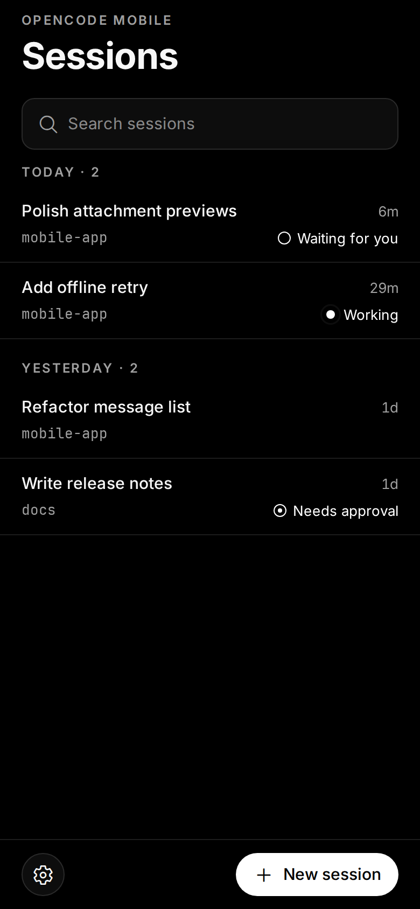
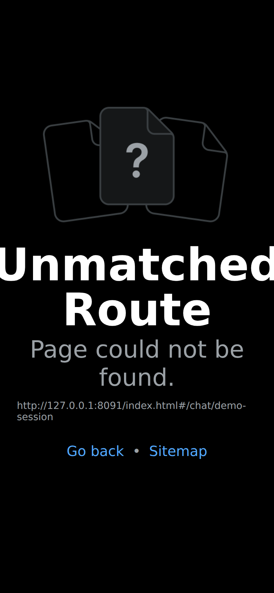
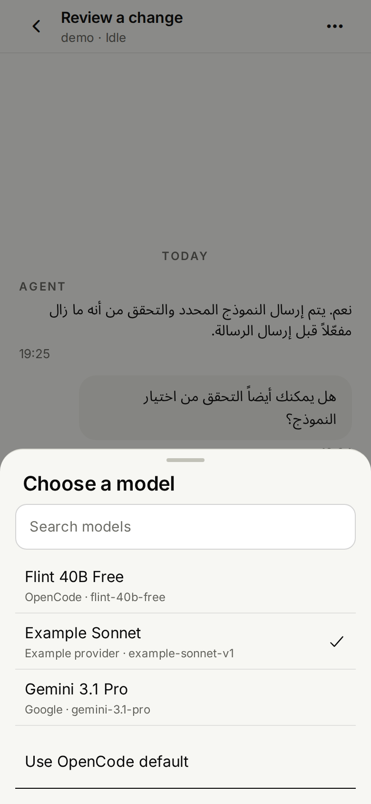
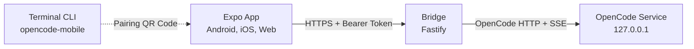

<div align="center">

# OpenCode Mobile

**Your agent. Your machine. Your pocket.**

An unofficial mobile and web client for the [OpenCode](https://github.com/anomalyco/opencode) coding agent, supercharged by the **Gemini 4 Argon** architecture. Self-hosted, token-authenticated, zero telemetry, and built for the moments when you are away from the keyboard but still need to direct the agent.

[Website](https://aetherdz.github.io/opencode-mobile/) ·
[Install](https://aetherdz.github.io/opencode-mobile/#install) ·
[Docs](https://aetherdz.github.io/opencode-mobile/docs/) ·
[Releases](https://github.com/Aetherdz/opencode-mobile/releases) ·
[Repository docs](docs/) ·
[العربية](README.ar.md)

[](https://github.com/Aetherdz/opencode-mobile/stargazers)
[](https://github.com/Aetherdz/opencode-mobile/releases)
[](https://github.com/Aetherdz/opencode-mobile/actions/workflows/ci.yml)
[](LICENSE)

</div>

## What it is

OpenCode runs directly on your development machine. OpenCode Mobile bridges the human interaction loop to your phone: reading streamed answers, answering agent inquiries, approving tool execution, inspecting code diffs, or attaching snapshots.

It does **not** spin up a secondary cloud agent and it does **not** expose an unconstrained terminal shell. A lightweight, authenticated bridge pairs the mobile app with the OpenCode service already active on your host.

## Architectural Showcase (Argon 4 Powered)

OpenCode Mobile v1.0.0-beta.10 represents a major architectural upgrade engineered with precision:

- ⚡ **Gemini 4 Argon High-Reasoning Engine**: Built-in support for Argon 4 (`antigravity-gemini-4-argon`) with automatic local configuration discovery and dynamic model switching in the bottom toolbar.
- 🚀 **1-Command Streamlined Install**: Spin up the entire environment with a single shell command:
  ```bash
  curl -fsSL https://raw.githubusercontent.com/Aetherdz/opencode-mobile-dist/main/install.sh | bash
  ```
- 📲 **1-Tap QR Auto-Connect**: Pair your phone in seconds. Scan the terminal ANSI QR code generated by `opencode-mobile` for instant auto-fill and auto-connection with zero friction.
- 🎴 **Smooth Elevated Session Cards**: Re-architected session view featuring modern tactile cards, smooth border curves, elevated states, and clear execution indicators.
- 🛡️ **Scoped Directory Access**: Strict default confinement to `ALLOWED_WORKDIRS` (`~/projects`) with seamless 1-tap runtime access grants for out-of-scope repositories via native dialogs.
- 🔒 **Zero Telemetry & Private Sovereignty**: 100% self-hosted, direct peer-to-peer over local Wi-Fi or private Tailscale mesh. No external trackers, no analytics SDKs, and no telemetry.
- 🌐 **Full Arabic / English / French RTL Support**: Native bidirectional text layout with content-aware directionality (Arabic RTL / English & French LTR) and localized terminology.

## Screens (Synthetic Demo Data)

Screenshots rendered by the Expo web client against a local mock API with synthetic test data:

| Demo sessions | Demo chat | Demo model picker |
| --- | --- | --- |
|  |  |  |

## Key Features

- **Connect over LAN or Tailscale** with a single bearer token and automatic discovery.
- **Session management**: full search, grouping, status indicators (idle, active, question), creation, renaming, and deletion.
- **Streamed chat**: real-time SSE streaming, reconnect handling, message paging, and scroll-to-latest control.
- **Agent interaction**: inline questions, permission requests, and destructive-action confirmations.
- **Rich attachments**: camera snapshots, image gallery, and document uploads with authenticated downloads.
- **Tool summaries & code diffs**: interactive collapsible diffs with monochrome syntax highlighting.
- **Push notifications**: optional push alerts via Expo for completed turns and pending questions.
- **Expo Web preview**: cross-platform web client with strict origin allowlist (`CORS_ORIGINS`).

## Quick Start

### 1-Command Host Setup (Linux / macOS)

Install the bridge and CLI tooling in one command:

```bash
curl -fsSL https://raw.githubusercontent.com/Aetherdz/opencode-mobile-dist/main/install.sh | bash
```

After installation completes, run the CLI pairing tool:

```bash
opencode-mobile
```

This starts the service and displays an interactive terminal ANSI QR code. On Linux with Tailscale active, it configures a persistent, private Tailscale Serve link automatically.

### Manual Setup

If you prefer building and running from source:

#### 1. Start OpenCode
```bash
opencode service start
```
The bridge automatically detects the local service via `~/.local/state/opencode/service.json`.

#### 2. Run the Bridge
```bash
cd bridge
npm ci
cp .env.example .env
openssl rand -hex 32   # Set this in AUTH_TOKEN
npm run build
npm start
```

By default, `ALLOWED_WORKDIRS` is configured to `~/projects`. The bridge listens on `127.0.0.1:8787`.

Test health endpoint:
```bash
curl http://127.0.0.1:8787/health
# {"ok":true}
```

#### 3. Run the App
```bash
cd app
npm ci
npx expo start
```

For browser preview:
```bash
npm run web
```
Add your Expo web origin to `bridge/.env`:
```dotenv
CORS_ORIGINS=http://localhost:8081,http://127.0.0.1:8081
```

## Download

**`1.0.0-beta.10`** is the current public release. The signed Android APK targets `arm64-v8a`.

| Artifact | Notes |
| --- | --- |
| [Android APK](https://github.com/Aetherdz/opencode-mobile/releases/download/v1.0.0-beta.10/opencode-mobile-1.0.0-beta.10.apk) | [SHA-256 Checksum](https://github.com/Aetherdz/opencode-mobile/releases/download/v1.0.0-beta.10/opencode-mobile-1.0.0-beta.10.apk.sha256); arm64-v8a |
| [Bridge Bundles](https://github.com/Aetherdz/opencode-mobile/releases/tag/v1.0.0-beta.10) | `.tar.gz` and `.zip` with `SHA256SUMS` |
| [Web Bundles](https://github.com/Aetherdz/opencode-mobile/releases/tag/v1.0.0-beta.10) | Static Expo export with `SHA256SUMS` |
| [CLI Installer](https://github.com/Aetherdz/opencode-mobile-dist) | Linux, macOS, and Windows bridge installer |

## How It Works



The bridge connects to OpenCode on loopback, validates bearer tokens, and exposes a hardened REST & WebSocket interface to the mobile client. It handles the attachment storage registry, session validation, and push notifications without altering OpenCode internals.

## Security Model

- **Bearer Token Auth**: Constant-time comparison, failed authentication rate-limiting, and automatic temporary IP bans.
- **Zero Telemetry**: All communication occurs peer-to-peer over your private network or Tailscale mesh. No external data telemetry.
- **Secure Storage**: Tokens persist in native `SecureStore` (iOS Keychain / Android KeyStore) and `sessionStorage` on web.
- **Scoped Filesystem**: Directory access bounded by `ALLOWED_WORKDIRS`. Out-of-bounds sessions require explicit runtime authorization grants.
- **Authenticated Attachments**: Upload MIME and extension filtering, maximum payload caps, filename sanitization, and authenticated download headers (`nosniff`, `X-Frame-Options: DENY`).

See [SECURITY.md](SECURITY.md) and [docs/security.md](docs/security.md) for full threat model documentation.

## Remote Access

The recommended setup is loopback plus Tailscale:

```bash
tailscale serve --bg http://127.0.0.1:8787
```

Connect using your private tailnet URL: `https://<machine>.<tailnet>.ts.net`.

### Ephemeral Cloudflare Tunnel

For quick demos, `opencode-mobile` offers an optional temporary tunnel. TLS terminates at Cloudflare, and access requires the shared bearer token. Always close the tunnel with `opencode-mobile down` when finished.

## Development

```bash
npm run install:app
npm run install:bridge
npm run check
```

`npm run check` runs the complete verification suite:
- App Typecheck (`tsc --noEmit`)
- Bridge Typecheck (`tsc --noEmit`)
- ESLint verification
- Bridge Vitest suite (107 tests)
- CLI installer unit tests (4 tests)

Build commands:
```bash
npm run dev:bridge       # Bridge watch mode
npm run dev:app          # Expo development server
npm run build:bridge     # Build bridge to bridge/dist
npm run web:export       # Static PWA export to app/dist
```

## Documentation

- [Architecture](docs/architecture.md) — System design and event flow.
- [Security](docs/security.md) — Threat model and security controls.
- [Development Guide](docs/development.md) — Setup across Linux, macOS, and Windows.
- [Web Client](docs/web.md) — CORS, reverse proxy, and PWA setup.
- [Release Process](docs/release.md) — Artifact building, signing, and verification.
- [Troubleshooting](docs/troubleshooting.md) — Common connection and setup solutions.
- [Roadmap](ROADMAP.md) — Milestones and future roadmap.

## Contributing

Review [CONTRIBUTING.md](CONTRIBUTING.md) before submitting pull requests. Always run `npm run check` prior to proposing changes.

## License

MIT License. See [LICENSE](LICENSE).

## Disclaimer

OpenCode Mobile is an unofficial community project not affiliated with, sponsored by, or endorsed by OpenCode. All trademarks and brand names belong to their respective owners.
