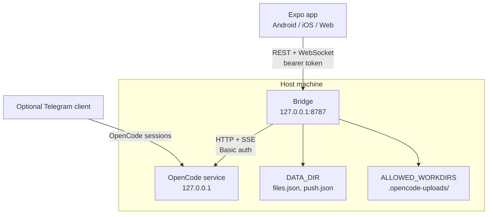
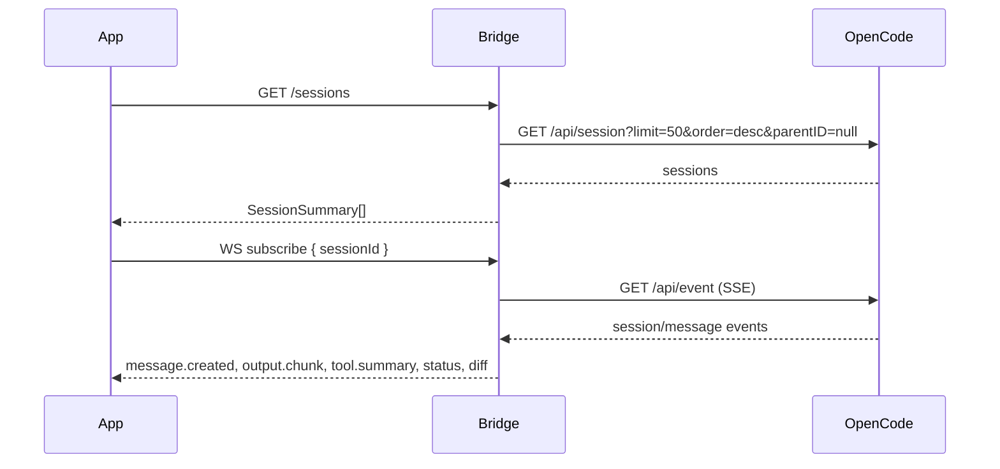

# Architecture

## Overview

OpenCode Mobile has two runnable pieces and one shared contract:

| Component | Runtime | Responsibility |
| --- | --- | --- |
| `app/` | Expo SDK 58 / React Native 0.88 | Phone and web UI. Stores the bridge token, renders sessions and chat, uploads files, and answers questions or permission requests. |
| `bridge/` | Node.js 22.13+ / Fastify | Authenticated local gateway. Talks to the OpenCode HTTP and SSE API, maps it to a smaller REST + WebSocket surface, and stores upload and push metadata. |
| `shared/contract.ts` | Type-only | REST and WebSocket shapes shared by the app and bridge. The app keeps a copy in `app/src/api/types.ts` so Metro does not watch outside the app root. |

The bridge is **not** an OpenCode replacement. It does not start an agent, keep
its own model state, or write to OpenCode's database. It is another client of
the service that is already running on the host.

## Trust boundaries

1. **Phone to bridge** — untrusted network path, even on a private tailnet.
   Protected by one bearer token, rate limits, and a small API surface.
2. **Bridge to OpenCode** — loopback only. The bridge refuses non-loopback
   OpenCode URLs and uses HTTP Basic auth with the OpenCode password.
3. **Bridge to the filesystem** — paths inside `ALLOWED_WORKDIRS` are allowed;
   an outside session requires an explicit runtime grant for that session ID
   and its canonical workdir. Uploads are written inside that workdir, not to a
   shared temp directory. The default root is `~/projects`.
4. **OpenCode to the machine** — outside this project's control. OpenCode can
   run tools with the permissions granted to it. The bridge does not add a
   sandbox. A session-specific bridge grant does not constrain OpenCode's OS
   permissions.

## Session flow

The app loads a session list over REST, then subscribes to one session over the
WebSocket. The bridge maintains one upstream SSE connection and fans events out
to subscribed sockets. It replays a bounded buffer when a client reconnects with
`lastEventId`.

The app sends prompts over the WebSocket (`message.send`) so it can receive an
acknowledgement and a prompt-specific error. Uploads use REST first; the
returned file IDs are attached to the WebSocket message.

## State and source tracking

`RuntimeState` keeps in-memory status, active questions, pending permission
requests, and the source of each session. It is not a database and does not
survive a bridge restart; the OpenCode service remains the source of truth for
sessions and messages.

A session can be marked:

- `idle` — no active turn.
- `running` — a turn is in progress.
- `waiting_input` — the agent asked a question.
- `needs_approval` — a tool permission request is pending.
- `error` — the last turn failed.

The bridge infers `source` from prompt metadata (`app` or `telegram`) and from
message metadata. A session used by both clients is shown as `both`. The app
does not run a Telegram bot; it only reflects the shared OpenCode session.

## REST surface

All routes except `/health` require `Authorization: Bearer <AUTH_TOKEN>`.
Errors use a stable shape: `{ "error": { "code": "...", "message": "..." } }`.

| Method | Path | Purpose |
| --- | --- | --- |
| `GET` | `/health` | Liveness check; unauthenticated. |
| `GET` | `/config` | Bridge version, workdirs, upload limits. |
| `GET` | `/workdirs` | Allowed project roots. |
| `GET` | `/sessions` | Session summaries. |
| `POST` | `/sessions` | Create a session in an allowed directory. |
| `GET` | `/sessions/:id` | One session. |
| `PATCH` | `/sessions/:id` | Rename. |
| `DELETE` | `/sessions/:id` | Delete. |
| `GET` | `/sessions/:id/messages` | Paged messages, cursor based. |
| `POST` | `/sessions/:id/messages` | REST fallback for sending a prompt. |
| `POST` | `/sessions/:id/uploads` | Multipart upload; returns file records. |
| `GET` | `/sessions/:id/diff` | Diff for the session. |
| `POST` | `/sessions/:id/stop` | Interrupt the current turn. |
| `GET` | `/permissions` | Pending permission requests. |
| `POST` | `/permissions/:id/reply` | Reply by request ID. |
| `POST` | `/sessions/:id/permissions/:requestId/reply` | Reply in session context. |
| `GET` | `/sessions/:id/questions` | Pending questions. |
| `POST` | `/questions/:id/reply` | Answer a question. |
| `POST` | `/questions/:id/reject` | Reject a question. |
| `GET` | `/files/:fileId` | Authenticated file download. |
| `GET` | `/files/:fileId/text` | Text preview for code and text files. |
| `POST` | `/push/register` | Register an Expo push token. |
| `POST` | `/push/unregister` | Remove a push token. |
| `POST` | `/push/test` | Send a test notification. |

## WebSocket surface

Request a one-time ticket with `POST /ws-ticket` (authenticated with the
bearer token), then connect to `/ws?ticket=<TICKET>`. Tickets expire after 30
seconds and are consumed on first use. The server sends a `hello` event with
the bridge version and active session rooms. The app then sends `subscribe`.
Messages are JSON with a `type` discriminator.

Client events:

| Type | Purpose |
| --- | --- |
| `subscribe` | Join a session room, optionally with `lastEventId`. |
| `unsubscribe` | Leave a room. |
| `message.send` | Send text, optional file IDs, delivery mode, and request ID. |
| `approval.reply` | `once`, `always`, or `reject`. |
| `session.stop` | Interrupt the turn. |
| `ping` | Liveness check. |

Server events include `output.chunk`, `tool.summary`, `diff`,
`approval.request`, `approval.resolved`, `status`, `session.updated`,
`message.created`, `message.completed`, `resume`, `ack`, `pong`, and `error`.
See `shared/contract.ts` for the exact fields.

## Upload pipeline

1. The app sends a multipart request to `POST /sessions/:id/uploads`.
2. The bridge resolves the session workdir and checks it is inside
   `ALLOWED_WORKDIRS`.
3. It validates the declared type, extension, magic bytes for binary formats,
   and text validity for code files.
4. It normalizes the filename, enforces per-file and total size limits, and
   writes the file to
   `<workdir>/.opencode-uploads/<sessionId>/<timestamp>-<id>-<name>` with mode
   `0600`.
5. It records the file in `DATA_DIR/files.json` and returns a file ID.
6. The app sends the file IDs with `message.send`. The bridge converts them to
   `file://` URIs and adds a read instruction to the prompt.

Downloads go through `GET /files/:fileId` and are authenticated. The bridge
serves the detected MIME type, not the client-declared one, and sets
`X-Content-Type-Options: nosniff`.

## Storage

| Path | Contents | Sensitive |
| --- | --- | --- |
| `DATA_DIR/files.json` | Upload registry with absolute paths and session IDs. | Yes |
| `DATA_DIR/push.json` | Expo push tokens and registration times. | Yes |
| `<workdir>/.opencode-uploads/` | Uploaded files. | Yes |
| OpenCode state | Sessions and messages. | Yes |
| Bridge logs | Request metadata with secrets redacted. | Treat as sensitive |

`DATA_DIR` is created with mode `0700`; `files.json` is written with mode
`0600`. `.opencode-uploads/` is created with mode `0700`. These files must not
be committed. The root `.gitignore` excludes them.

## Reconnect and failure behavior

- The bridge retries the upstream SSE connection with exponential backoff.
- A WebSocket client can reconnect and subscribe with `lastEventId`; the bridge
  replays buffered events for that session.
- If the bridge restarts, in-memory status and pending questions are lost.
  Reload the session list and pending questions from REST.
- If OpenCode restarts, the bridge reconnects but cannot recover events that
  were emitted while it was disconnected.
- Prompt sends are rejected with `busy` when the session is already running,
  unless the client explicitly uses `delivery: "steer"`.

## Push notifications

Push is optional and disabled with `PUSH_ENABLED=0`. The bridge registers Expo
push tokens in `DATA_DIR/push.json` and sends generic notifications for
finished turns, failures, questions, and permission requests. Payloads contain
session IDs and generic text, not message bodies. Expo's push service is a
third party and is outside the bridge's trust boundary.

## Non-goals

- A terminal or shell UI on the phone.
- A second agent or a separate session store.
- Multi-user accounts or per-session ACLs.
- End-to-end encryption between the app and the bridge.
- A built-in Telegram bot. Telegram is an optional separate OpenCode client.
- Model or agent switching. The current app does not expose those controls.

## Version compatibility

The bridge is written against the OpenCode API verified in
[opencode-api-notes.md](opencode-api-notes.md). OpenCode is evolving; event
names and response envelopes can change. Pin a known-good OpenCode version for
production use and run the bridge tests after upgrading.
